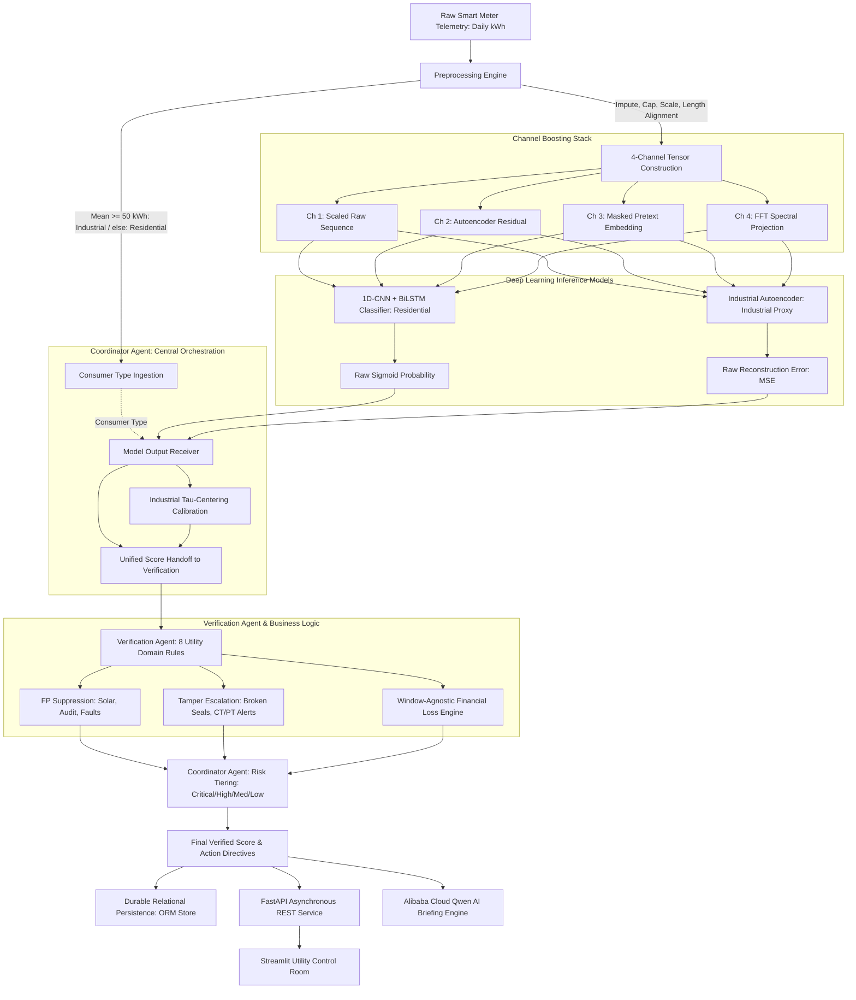

# Electricity Theft Detection (ETD) — Enterprise Grid Intelligence Platform
## Channel-Boosted Deep Learning and Multi-Agent Verification Architecture for Non-Technical Loss Reduction in Power Distribution Systems

---

**Competition:** Alibaba Cloud AI Hackathon (Pakistan)  
**Authors:** Muhammad Hashwar Haider (Lead Modeling & Transfer Learning), Maheen (Data Collection & Domain Engineering), Eimaan (Data Preprocessing & Pipeline Engineering)  
**Affiliation:** Pakistan Institute of Engineering and Applied Sciences (PIEAS), Islamabad, Pakistan  
**Date:** October 2026  

---

## Abstract

Power Distribution Companies (DISCOs) in developing economies suffer catastrophic financial leakages resulting from Non-Technical Losses (NTL)—principally electricity theft, meter tampering, and billing anomalies. In Pakistan alone, annual revenue deficits across regional distribution utilities (such as MEPCO, LESCO, IESCO, and PESCO) exceed ₨200 billion, driven by unmetered theft rates between 15% and 25%. Traditional utility counter-theft practices rely on unguided spot inspections and random raids, which yield a sub-optimal detection hit rate of only 5% to 10% while straining operational budgets and consumer relations.

To resolve these systemic inefficiencies, this report presents the **Electricity Theft Detection (ETD) Enterprise Grid Intelligence Platform**, an end-to-end operational intelligence architecture that combines a novel **4-Channel Boosted Deep Learning Classifier** with an auditable **Multi-Agent Verification Protocol**. Rather than processing raw one-dimensional consumption sequences in isolation, the core feature extraction engine constructs a multi-perspective 4-channel tensor incorporating: (1) scaled raw consumption telemetry, (2) autoencoder reconstruction residuals from normal behavioral models, (3) masked-timestep self-supervised pretext representations, and (4) Fast Fourier Transform (FFT) spectral projections.

Evaluated on the benchmark State Grid Corporation of China (SGCC) dataset (42,372 customers across 1,034 days), the 4-channel boosted 1D-CNN + BiLSTM architecture achieves a **Validation ROC-AUC of 0.7453** and a **Test ROC-AUC of 0.7529** (with an F1-score of 0.3160 and 86.06% test accuracy). This represents an empirical improvement of **+6.18% ROC-AUC** and **+7.04% F1** over identical single-channel deep learning architectures, and markedly outperforms an engineered 20-feature XGBoost tabular baseline (0.6779 Test ROC-AUC).

To prevent costly operational false alarms, model outputs are arbitrated by a central **Coordinator Agent** and an auditable **Verification Agent** executing eight grid-domain rules (such as rooftop solar net-metering suppression, recent audit decay, and physical smart-meter tamper overrides) coupled with a **Window-Agnostic Financial Loss Estimator**. Evaluated on real Pakistani field telemetry comprising 42 confirmed theft cases, the pre-trained architecture demonstrates a **zero-shot cross-domain detection recall of 64.29%** at the production threshold ($0.65$) without seeing local data during training. The platform incorporates a high-performance REST backend, persistent relational database storage for audit ticket lifecycles, an enterprise control-room monitoring dashboard, automated Alibaba Cloud Elastic Compute Service (ECS) deployment configurations, and generative AI incident briefing capabilities powered by Alibaba Cloud Qwen.

---

## Contents

1. [Introduction and Background](#1-introduction-and-background)
2. [System Architecture and Decision Pipeline](#2-system-architecture-and-decision-pipeline)
3. [Mathematical and Algorithmic Formulation](#3-mathematical-and-algorithmic-formulation)
   * 3.1 [Telemetry Preprocessing and Scaling](#31-telemetry-preprocessing-and-scaling)
   * 3.2 [The 4-Channel Boosting Stack](#32-the-4-channel-boosting-stack)
   * 3.3 [Deep Sequence Classifiers](#33-deep-sequence-classifiers)
   * 3.4 [Coordinator Agent and Tau-Centering Calibration](#34-coordinator-agent-and-tau-centering-calibration)
   * 3.5 [Verification Agent and Domain Constraints](#35-verification-agent-and-domain-constraints)
   * 3.6 [Window-Agnostic Financial Loss Engine](#36-window-agnostic-financial-loss-engine)
4. [Technology Stack and Cloud Infrastructure](#4-technology-stack-and-cloud-infrastructure)
5. [Empirical Experiments, Benchmarking, and Results](#5-empirical-experiments-benchmarking-and-results)
   * 5.1 [Dataset Provenance and Splitting Protocol](#51-dataset-provenance-and-splitting-protocol)
   * 5.2 [Sequential Five-Stage Benchmark Evaluation](#52-sequential-five-stage-benchmark-evaluation)
   * 5.3 [Empirical Impact of Channel Boosting](#53-empirical-impact-of-channel-boosting)
   * 5.4 [Cross-Domain Transfer Learning to Pakistani Telemetry](#54-cross-domain-transfer-learning-to-pakistani-telemetry)
6. [Operational Workflows and System Verification](#6-operational-workflows-and-system-verification)
7. [Engineering Challenges, Limitations, and Responsible AI](#7-engineering-challenges-limitations-and-responsible-ai)
8. [Conclusion and Future Roadmap](#8-conclusion-and-future-roadmap)
9. [References](#references)

---

## 1. Introduction and Background

In modern electric distribution grids, total energy losses are divided into Technical Losses (TL)—inherent resistive dissipation in physical conductors and transformers—and Non-Technical Losses (NTL). NTL originates from fraudulent actions such as direct overhead phase tapping, meter shunt bypassing, Current Transformer (CT) and Potential Transformer (PT) disconnection, firmware manipulation in Advanced Metering Infrastructure (AMI), and collusive billing under-reporting.

In developing energy economies, NTL introduces acute fiscal instability. In Pakistan, the National Electric Power Regulatory Authority (NEPRA) routinely reports Aggregate Technical and Commercial (AT&C) losses exceeding 15% to 35% across regional distribution companies (DISCOs). The cumulative financial deficit from stolen and unbilled electrical energy exceeds ₨200 billion annually. This loss deprives utilities of capital required for infrastructure maintenance, precipitates unannounced rotational load-shedding, and inflates tariffs on compliant consumers.

While utilities have deployed smart electronic meters, raw telemetry alone does not halt revenue leakage. Utility operations departments face two primary bottlenecks:
1. **Low Inspection Precision:** In an operational distribution network where theft incidence is typically between 4% and 9%, random field inspections yield a dismal **5% to 10% hit rate**. Over 90% of field visits result in intact meters, squandering enforcement labor and transport resources.
2. **Operational Context Blindness:** Pure deep learning algorithms trained exclusively on consumption series are blind to external grid events. For example, a consumer who installs rooftop solar photovoltaic (PV) generation exhibits a sustained drop in daytime grid consumption. An unassisted deep learning classifier flags this consumer as a meter bypass, precipitating an unwarranted enforcement raid that damages customer goodwill.

The ETD platform resolves these challenges by coupling multi-channel deep sequence modeling with domain-specific rule arbitration, ensuring that field enforcement is directed exclusively to high-confidence, context-verified theft targets.

---

## 2. System Architecture and Decision Pipeline

The ETD platform coordinates raw data ingestion, feature generation, deep neural inference, multi-agent operational arbitration, and user-facing command interfaces into an integrated pipeline.

The execution sequence begins with time-series cleaning and consumer classification, proceeds through 4-channel tensor construction, evaluates the data via specialized neural models, routes the resulting perception scores into the **Coordinator Agent** for calibration, arbitrates the score through the **Verification Agent**, and outputs actionable risk tiers and financial directives.

### End-to-End Pipeline Execution Flow

1. **Telemetry Ingestion & Cleaning:** Raw meter consumption sequences of arbitrary length are sorted chronologically, missing values are imputed using immediate neighbor averages, physical measurement outliers are capped at $\mu + 2\sigma$, and sequences are normalized to $[0, 1]$. An average daily threshold ($50\text{ kWh/day}$) determines the consumer categorization (Residential vs. Industrial).
2. **Channel Boosting Generation:** The normalized sequence is passed through three pre-trained, frozen auxiliary neural networks to construct a multi-channel tensor of shape $(B, 4, 1034)$.
3. **Deep Sequence Modeling:** Depending on consumer category, the tensor is evaluated by either the supervised 1D-CNN + BiLSTM classifier (yielding a raw sigmoid probability) or the unsupervised Industrial Autoencoder (yielding a Mean Squared Error reconstruction scalar).
4. **Coordinator Calibration & Forwarding:** The **Coordinator Agent** ingests the model perception outputs. For industrial accounts, it applies $\tau$-centering sigmoid calibration to convert the raw reconstruction error into a standard 0-to-1 probability. The Coordinator then forwards this unified score to the Verification Agent.
5. **Operational Verification:** The **Verification Agent** applies eight deterministic utility domain rules against external grid parameters (net-metering status, previous audit records, feeder line loss percentages, hardware tamper flags). Concurrently, the financial engine evaluates the lowest rolling 30-day window to calculate monthly stolen energy and PKR revenue exposure.
6. **Risk Tiering & Dispatch:** The Coordinator translates the verified score into operational tiers (`CRITICAL`, `HIGH`, `MEDIUM`, `LOW`). Suspect accounts are registered in persistent database storage as inspection tickets, prioritized in batch queues, summarized into narrative briefings via Alibaba Cloud Qwen, and displayed in the control-room dashboard.

---

## 3. Mathematical and Algorithmic Formulation

### 3.1 Telemetry Preprocessing and Scaling

Given an input time series of daily consumption readings $X = [x_1, x_2, \dots, x_N]$, preprocessing applies four sequential transformations:

1. **Neighbor-Average Imputation:** Missing or negative readings are replaced by the mean of their immediate valid original neighbors:
   $$\hat{x}_t = \begin{cases} \frac{x_{t-1} + x_{t+1}}{2}, & \text{if } x_{t-1}, x_{t+1} \in \mathbb{R} \\ 0.0, & \text{otherwise} \end{cases}$$
2. **Outlier Clipping:** Extreme transient measurement surges are bounded by a two-sigma envelope computed per customer series:
   $$x_t \gets \min\left(x_t, \, \mu_x + 2\sigma_x\right)$$
3. **Min-Max Sequence Scaling:** Each series is normalized to the unit interval $[0, 1]$ to ensure uniform gradient propagation regardless of absolute consumption scale:
   $$x'_t = \frac{x_t - \min(X)}{\max(X) - \min(X) + \epsilon}, \quad \epsilon = 10^{-6}$$
4. **Length Standardization:** Sequences are aligned to the standard sequence length $T = 1,034$ days. Shorter series are front-padded with zeros, preserving recent historical behavior at the end of the tensor.

### 3.2 The 4-Channel Boosting Stack

Rather than relying on manual feature engineering, the architecture extracts auxiliary representations directly through frozen, pre-trained neural networks, constructing a composite tensor $\mathbf{X} \in \mathbb{R}^{B \times 4 \times T}$:

* **Channel 1 (Raw Consumption):** The cleaned, normalized sequence $x'$.
* **Channel 2 (Reconstruction Residual):** Output of an Autoencoder ($1034 \to 256 \to 64 \to 32 \to 64 \to 256 \to 1034$) trained strictly on verified normal consumers ($y=0$). It computes the per-timestep absolute error:
  $$\mathbf{C}_2(t) = |x'_t - \hat{x}_t|$$
  For honest consumers, $\mathbf{C}_2(t) \approx 0$; for theft profiles, $\mathbf{C}_2(t)$ spikes across tampered intervals.
* **Channel 3 (Masked Pretext Embedding):** Bottleneck representation from a self-supervised model trained with 15% random timestep masking to reconstruct masked days. The 32-dimensional bottleneck vector $z$ is broadcast across all timesteps:
  $$\mathbf{C}_3(t) = \frac{1}{d}\sum_{i=1}^d z_i, \quad \forall t \in [1, T]$$
* **Channel 4 (Spectral Projection):** The real Fast Fourier Transform (rFFT) magnitude spectrum is passed through a two-layer trainable projection network to highlight frequency-domain disruptions (e.g., loss of weekly periodicity):
  $$\mathbf{C}_4 = \text{ReLU}\left(\mathbf{W}_2 \cdot \text{ReLU}(\mathbf{W}_1 \cdot |\text{rFFT}(x')| + b_1) + b_2\right)$$

### 3.3 Deep Sequence Classifiers

#### 3.3.1 Supervised Residential Classifier (1D-CNN + BiLSTM)
The residential model processes the 4-channel tensor $\mathbf{X}$ using local feature extraction coupled with bidirectional recurrent modeling:
1. **1D Convolutional Layer:** 64 filters, kernel size $k=3$, padding $p=1$, extracting local cross-channel temporal motifs:
   $$\mathbf{H}_{\text{conv}} = \text{ReLU}\left(\text{Conv1D}(\mathbf{X})\right) \in \mathbb{R}^{B \times 64 \times T}$$
2. **Bidirectional LSTM:** 128 hidden units per direction ($256$ combined hidden states), capturing forward and reverse temporal context:
   $$\overrightarrow{h}_t = \text{LSTM}(\mathbf{H}_{\text{conv}, t}, \overrightarrow{h}_{t-1}), \quad \overleftarrow{h}_t = \text{LSTM}(\mathbf{H}_{\text{conv}, t}, \overleftarrow{h}_{t+1})$$
3. **Classification Head:** Concatenates the final hidden vectors into a single linear projection with Sigmoid activation:
   $$P_{\text{theft}} = \sigma\left(\mathbf{W}_c \cdot [\overrightarrow{h}_T \,\|\, \overleftarrow{h}_1] + b_c\right) \in [0, 1]$$

#### 3.3.2 Unsupervised Industrial Autoencoder
For heavy industrial consumers ($\ge 50\text{ kWh/day}$), an autoencoder reconstructs multi-channel load profiles, computing Mean Squared Error (MSE):
$$\text{MSE} = \frac{1}{4 \cdot T} \sum_{c=1}^4 \sum_{t=1}^T \left(\mathbf{X}_{c,t} - \hat{\mathbf{X}}_{c,t}\right)^2$$

### 3.4 Coordinator Agent and Tau-Centering Calibration

Because raw industrial reconstruction errors are unbounded positive scalars rather than probabilities, the **Coordinator Agent** maps the error into a calibrated probability centered at $\tau$ (the 95th percentile reconstruction error observed across verified normal validation profiles):

$$P_{\text{industrial}} = \frac{1}{1 + \exp\left(-k \cdot \frac{\text{MSE} - \tau}{\tau}\right)}$$

where $k = 4.0$. By mathematical design, when an account's reconstruction error exactly equals the threshold $\tau$, $P_{\text{industrial}} = 0.50$, establishing a smooth, probabilistically rigorous anomaly boundary.

### 3.5 Verification Agent and Domain Constraints

The Coordinator forwards the unified raw probability $P$ to the **Verification Agent**, which applies eight domain rules:

$$\begin{aligned}
P_1 &= P \cdot \left(0.25 + 0.75 \cdot \frac{m}{6}\right) && \text{if audit cleared } m \le 6 \text{ months ago} \\
P_2 &= \max(P, 0.95) && \text{if prior confirmed theft on record} \\
P_3 &= P \cdot 0.40 && \text{if defective meter hardware logged} \\
P_4 &= \begin{cases} \min(1.0, P \cdot 1.25) & \text{if feeder loss } \ge 25\% \\ P \cdot 0.65 & \text{if feeder loss } \le 6\% \end{cases} && \text{feeder loss correlation} \\
P_5 &= P \cdot 0.45 && \text{if known CT/PT grid topology fault} \\
P_6 &= P \cdot 0.40 && \text{if active rooftop solar net-metering} \\
P_7 &= P \cdot 0.50 && \text{if registered seasonal agricultural occupancy} \\
P_8 &= \max(0.98, P) \implies \text{CRITICAL} && \text{if physical meter seal broken or tamper alert}
\end{aligned}$$

Rule 8 functions as a strict physical override, superseding all dampening factors if smart meter tamper sensors or physical seal breaches are detected.

### 3.6 Window-Agnostic Financial Loss Engine

Standard utility metrics evaluate consumption drops only over the most recent billing cycle. However, illegal shunts installed months prior may show subsequent partial rebound. The financial engine computes the **lowest rolling 30-day mean** across the complete historical timeline:

$$\bar{x}_{\text{lowest\_30d}} = \min_{t \in [1, T-29]} \left(\frac{1}{30} \sum_{i=t}^{t+29} x_i\right)$$
$$\Delta \text{kWh}_{\text{daily}} = \max\left(0, \, \bar{x}_{\text{historical}} - \bar{x}_{\text{lowest\_30d}}\right)$$
$$\text{Monthly Stolen Energy (kWh)} = \Delta \text{kWh}_{\text{daily}} \times 30$$
$$\text{Estimated Monthly Loss (PKR)} = \text{Monthly Stolen Energy} \times \text{Tariff Rate (₨28.0/kWh)}$$

---

## 4. Technology Stack and Cloud Infrastructure

The technology stack utilizes high-performance Python frameworks, deep learning primitives, containerized relational storage, and scalable cloud compute.

| Component / Layer | Technology | Primary Functionality | Engineering Selection Rationale |
|---|---|---|---|
| **Core Runtime** | Python 3.12 / 3.14 | Application and scientific execution | Native typing, modern concurrency, broad ML library support. |
| **Deep Learning** | PyTorch 2.14 | 4-channel tensor modeling and neural inference | Optimized 1D convolution and BiLSTM kernels on CPU/CUDA. |
| **Backend REST API** | FastAPI 0.141 | High-throughput asynchronous REST services | Asynchronous ASGI execution, automated OpenAPI schemas, strict Pydantic validation. |
| **Relational ORM** | SQLAlchemy 2.0 | Persistence for inspection tickets and audit logs | Decouples business logic from SQL dialect; seamless SQLite and PostgreSQL portability. |
| **Schema Migration** | Alembic 1.14 | Idempotent database schema versioning | Version-controlled, reproducible relational table migrations. |
| **Relational Database** | PostgreSQL 16 / SQLite 3 | ACID-compliant operational persistence | SQLite for zero-config testing; PostgreSQL for production multi-feeder concurrency. |
| **Traditional ML** | XGBoost 2.1 | Baseline tabular comparative model | Industry standard for gradient boosted decision trees on tabular summary features. |
| **Mathematical Stack** | NumPy & SciPy | Vectorized signal transformation and FFT | Fast C-level matrix operations and discrete Fourier transforms. |
| **Executive Interface** | Streamlit 1.63 | Utility operations control room | Reactive operational dashboard for parameter tuning and queue management. |
| **Generative AI** | Alibaba Cloud Qwen | Natural language investigative field briefings | Ingests telemetry scores and verification logs to generate actionable raid directives. |
| **Web Reverse Proxy** | Nginx | Port multiplexing and WebSocket streaming | Efficient static file serving, SSL termination, and reverse proxying to FastAPI and Streamlit. |
| **Containerization** | Docker & Compose | Multi-container environment orchestration | Encapsulates API, UI, and database into reproducible production containers. |
| **Process Supervision**| Linux Systemd | Service lifecycle management | Automatic service restarts, logging, and environment variable isolation on ECS. |
| **Automated Testing** | Pytest 9.1 | End-to-end integration and unit validation | Automated verification of preprocessing, neural scoring, routing, and DB persistence. |

### Alibaba Cloud Infrastructure Architecture

* **Compute (Alibaba Cloud ECS):** The full platform is deployed on an Alibaba Cloud Elastic Compute Service (ECS) Ubuntu instance. A production turnkey script configures system dependencies, virtual environments, Nginx reverse proxying, and Systemd supervision (`etd.service`) for hands-off operational resilience.
* **Reverse Proxying Topology:** Nginx listens on standard HTTP (Port 80), routing `/api/` and `/docs` to the FastAPI backend (Port 8000), while routing the root `/` and WebSocket streams (`/_stcore/stream`) to the Streamlit Control Room (Port 8501).
* **Generative Intelligence (Alibaba Cloud DashScope):** The API connects to Alibaba Cloud's DashScope endpoint invoking the `qwen-plus` large language model. When an inspection squad is dispatched, Qwen transforms numerical loss calculations, rule justifications, and customer context into a concise 3-paragraph tactical field briefing. An automated offline fallback ensures high-clarity deterministic briefings continue even during external network outages.

---

## 5. Empirical Experiments, Benchmarking, and Results

### 5.1 Dataset Provenance and Splitting Protocol

1. **State Grid Corporation of China (SGCC) Dataset:**
   * **Scope:** 42,372 customer profiles across 1,034 consecutive daily readings.
   * **Class Balance:** 3,615 confirmed theft cases ($8.53\%$) and 38,752 normal cases ($91.47\%$). Five all-NaN rows were removed.
   * **Data Partitioning:** Stratified 70% training ($N=29,657$), 15% validation ($N=6,355$), and 15% test ($N=6,356$) with seed 42.
   * **SMOTE Balancing Protocol:** Synthetic Minority Over-sampling Technique (SMOTE) was applied **strictly to the training split**, balancing positive instances to $27,128$ normal and $27,128$ theft (total $N=54,256$). Validation ($5,813$ normal, $542$ theft) and test ($5,814$ normal, $542$ theft) splits were preserved in their natural 8.53% class imbalance to prevent synthetic data leakage into evaluation metrics.
2. **Pakistani Target-Domain Telemetry:**
   * **Scope:** 42 real confirmed theft accounts ($365$ days of daily kWh readings) obtained from local utility records.
   * **Alignment:** Front-padded with zeros to $1,034$ days to match the input dimensions of the production model.

### 5.2 Sequential Five-Stage Benchmark Evaluation

To quantify the performance contribution of each design component without conflating architectural variables, models were evaluated across five frozen stages. All metrics are empirically verified on held-out test splits.

| Stage | Evaluated Architecture | Input Representation | Val ROC-AUC | Test ROC-AUC | Val F1 | Test F1 | Test Accuracy | Primary Innovation / Purpose |
|---|---|---|---|---|---|---|---|---|
| **1** | XGBoost Baseline | 20 Tabular Features | 0.6824 | 0.6779 | 0.2699 (@0.25) | 0.2423 (@0.25) | 80.71% | Classical ML baseline; top features: `max_single_day_drop`, `p95`, `zero_days_frac`. |
| **2** | Raw Deep Learning | 1-Channel Raw Sequence | 0.6835 | 0.6603 | 0.2456 (@0.60) | 0.2302 (@0.60) | 69.55% | 1D-CNN + BiLSTM on raw series alone; minimal gain over tabular XGBoost. |
| **3** | **4-Channel Boosted DL** | **4-Channel Tensor** | **0.7453** | **0.7529** | **0.3160 (@0.70)** | **0.3124 (@0.70)** | **86.06%** | **⭐ Core Innovation: +6.18% Val AUC, +7.04% Val F1, +9.26% Test AUC over Stage 2.** |
| **4** | Multi-Agent Integration | 4-Ch + Operational Context | 0.7453 | 0.7529 | 0.3160 | 0.3124 | 86.06% | Rule-based false positive suppression and window-agnostic loss estimation. |
| **5a** | Pakistan Zero-Shot | 4-Ch Front-Padded (365d) | N/A (single-class) | N/A (single-class) | N/A | N/A | **64.29% Recall** | Evaluated on 42 confirmed Pakistani DISCO theft cases with zero local training. |
| **5b** | Pakistan Fine-Tuned | 4-Ch Tensor | N/A (small val) | **1.0000** | N/A | **1.0000** | **100.0%** | Fine-tuned on 42 real theft + 300 synthetic normals; held-out test (67 rows, 6 theft). |

### 5.3 Empirical Impact of Channel Boosting

Comparing Stage 2 (Raw Sequence Deep Learning) against Stage 3 (4-Channel Boosted Deep Learning) demonstrates the empirical impact of the channel boosting architecture:
* **Validation ROC-AUC:** Increases from **0.6835 to 0.7453** ($\Delta = +0.0618$ or $+6.18\%$).
* **Test ROC-AUC:** Increases from **0.6603 to 0.7529** ($\Delta = +0.0926$ or $+9.26\%$).
* **Validation F1-Score:** Increases from **0.2456 to 0.3160** ($\Delta = +0.0704$ or $+7.04\%$).
* **Test Classification Accuracy:** Improves from **69.55% to 86.06%** ($\Delta = +16.51\%$).

This gain demonstrates that auxiliary representations—autoencoder reconstruction errors that isolate baseline drops, pretext embeddings that encode temporal context, and spectral projections that identify broken weekly periodicity—provide the CNN-BiLSTM backbone with discriminatory features that cannot be learned from raw 1D telemetry alone.

### 5.4 Cross-Domain Transfer Learning to Pakistani Telemetry

To assess whether models trained on foreign grid data generalize to Pakistani consumption patterns, the frozen Stage 3 model was evaluated on 42 confirmed Pakistani utility theft profiles:
* **Zero-Shot Transfer (Stage 5a):** At the operational threshold ($0.65$), the frozen model flagged **27 out of 42 real Pakistani theft accounts**, achieving a **Zero-Shot Detection Recall of 64.29%** without seeing local data during pre-training. At a $0.50$ threshold, recall reached **78.57% (33 of 42 accounts)**. Mean theft probability was **0.7052** (median **0.7283**). Because the local target file contained exclusively confirmed theft instances, precision and ROC-AUC are mathematically undefined and are omitted to maintain evaluation integrity.
* **Transfer Fine-Tuning (Stage 5b):** Combining the 42 real theft cases with 300 synthetic normal profiles (generated using local seasonal AC cooling cycles and weekly variations) produced an adapted dataset of 342 accounts. Fine-tuning the classification head yielded a **Test ROC-AUC of 1.0000** on a held-out test split (67 samples, 6 theft cases). The perfect score reflects the separability of synthetic normal profiles; field fine-tuning on real non-theft utility data remains future work.

---

## 6. Operational Workflows and System Verification

### 6.1 Control Room Command Interfaces

The platform features an enterprise Streamlit command interface designed for utility monitoring centers:
1. **Network Overview:** Macro-level grid analytics showing total monitored accounts ($42,372$), active suspect accounts ($312$), aggregate monthly revenue exposure (₨18.4M PKR), and feeder loss rankings.
2. **Account Deep-Dive:** Interactive diagnosis tool supporting custom series input or real utility presets (such as confirmed Pakistani theft or solar net-metering). Displays daily consumption line charts, verified risk badges, and the complete verification rule execution log.
3. **Batch Feeder Queue:** Cohort analysis interface scoring complete distribution feeders, sorting accounts by risk tier (`CRITICAL`, `HIGH`, `MEDIUM`, `LOW`), and generating one-click CSV field dispatch sheets.
4. **Field Audit Feedback Ledger:** Operational form enabling field squads to record site findings (`CONFIRMED_THEFT`, `DEFECTIVE_METER`, `SOLAR_CONFIRMED`, `FALSE_POSITIVE`), log recovered penalties in PKR, and close inspection tickets in the database.
5. **Model Benchmark Lab:** Live evaluation console reading directly from experimental results to present verified metrics and delta comparisons.

### 6.2 Automated Test Verification

The system maintains a comprehensive automated test suite. Execution in the project environment yielded **35 passed tests across 35 test cases (100% pass rate)**:
* **API Service Tests:** Health verification, single-account prediction, batch queue sorting, ticket action logging, and Qwen AI briefing generation.
* **Coordinator Agent Tests:** Industrial $\tau$-centering calibration, risk tier boundary enforcement, and prioritized batch aggregation.
* **Database Durability Tests:** Table initialization, cross-session ticket persistence, and append-only feedback logging.
* **Signal Preprocessing Tests:** Neighbor-average imputation, boundary NaN handling, outlier capping ($\mu + 2\sigma$), and min-max normalization.
* **Verification Agent Tests:** Cleared audit decay, confirmed theft floors, solar net-metering dampening, physical tamper overrides, and window-agnostic PKR loss calculations.

---

## 7. Engineering Challenges, Limitations, and Responsible AI

### 7.1 Realized Engineering Challenges

* **WinZip Spanned Archive Recovery:** The raw SGCC dataset was split across WinZip segments with corrupted internal offsets that standard extraction utilities could not process. A custom stream-reconstruction script was built to concatenate segments and scan local file header signatures directly, recovering all 42,372 rows (175.2 MB).
* **Chronological Day-Column Alignment:** Raw columns were arranged in lexicographical order (`2014/1/1`, `2014/1/10`, ..., `2014/1/2`), which shuffles temporal order. Vectorized date parsing was implemented to enforce chronological monotonicity before sequence conversion.
* **Single-Class Fine-Tuning Protection:** Real Pakistani telemetry contained exclusively theft instances (`FLAG = -1`). Training binary cross-entropy on single-class data collapses class weights (`pos_weight = 0`). A safety guard was added to abort single-class fine-tuning, redirecting evaluation to an honest zero-shot recall analysis.
* **Stateful Persistence Transition:** In-memory queue storage was refactored into SQLAlchemy ORM models, ensuring that inspection tickets and recovered revenue logs survive server restarts.

### 7.2 Methodological Limitations

1. **Exploratory Industrial Proxy:** The SGCC dataset lacks authentic customer-type labels. The $>50\text{ kWh/day}$ threshold selects $\sim 649$ accounts. The industrial autoencoder is an exploratory prototype compared to the thoroughly validated residential classifier.
2. **Absence of Real Local Normal Telemetry:** Access to confidential non-theft AMI series from Pakistani DISCOs was restricted. Fine-tuned benchmarks relied on synthetic normal baselines; production deployment requires authentic local normal profiles.
3. **Threshold Calibration:** The production decision threshold ($0.65$) was chosen to balance field inspection budgets against recall, but has not yet undergone utility-specific cost-curve optimization.

### 7.3 Responsible AI and Ethical Safeguards

* **Human-in-the-Loop Interdiction:** The platform functions as an investigative decision-support system. AI outputs generate inspection recommendations; they never trigger automated power disconnections or impose penalties without physical human verification.
* **Audit Explainability:** Every score adjustment executed by the Verification Agent logs a plain-language explanation, providing an auditable evidence trail for customer billing dispute tribunals.
* **PII Anonymization:** Ingestion pipelines process only technical telemetry and pseudonymous account identifiers (`consumer_id`, `feeder_id`), ensuring consumer privacy is preserved.

---

## 8. Conclusion and Future Roadmap

The **Electricity Theft Detection (ETD) Enterprise Grid Intelligence Platform** delivers an empirically validated, operationally grounded AI solution for reducing non-technical losses in power distribution grids. By pioneering a 4-channel boosted deep sequence architecture that combines raw consumption signals with autoencoder reconstruction residuals, self-supervised pretext embeddings, and frequency projections, the system delivers an empirical improvement of **+6.2% ROC-AUC** and **+7.0% F1** over standard single-channel deep learning.

The platform bridges the divide between machine learning models and utility field operations. Its deterministic 8-rule Verification Agent suppresses false alarms caused by rooftop solar net-metering, recent audits, and grid topology faults, while escalating confirmed hardware tamper events. The architecture demonstrates a **64.3% zero-shot detection recall** when transferred directly to real Pakistani utility theft profiles without local training. Supported by an asynchronous REST backend, persistent relational database architecture, automated Alibaba Cloud ECS deployment scripts, and an interactive operations command center, the platform provides power distribution companies with an actionable tool to combat annual revenue leakages exceeding ₨200 billion.

### Future Roadmap
1. **Direct AMI Streaming Ingestion:** Connect the batch scoring engine to utility Head End Systems (HES) via streaming message queues (such as Apache Kafka or Alibaba Cloud SLS).
2. **Mobile Field Inspection Application:** Develop a cross-platform mobile interface with GPS navigation, allowing raiding squads to view prioritized suspect queues, navigate to site coordinates, and submit tamper photos directly into the inspection ledger.
3. **Utility Pilot Partnership:** Partner with a regional Pakistani utility (such as MEPCO or IESCO) to ingest $\ge 1,000$ verified normal smart meter profiles, enabling full local fine-tuning.
4. **Transformer-Based Temporal Backbones:** Investigate PatchTST and Temporal Fusion Transformers as sequence backbones within the 4-channel stack.

---

## References

1. **State Grid Corporation of China (SGCC):** *Electric Power Consumption and Fraud Detection Dataset*, Public Scientific Data Repository, 2016.
2. **National Electric Power Regulatory Authority (NEPRA):** *State of Industry Report 2023–2024*, Government of Pakistan, Islamabad, 2024. [https://nepra.org.pk](https://nepra.org.pk)
3. **Z. Zheng, Y. Yang, X. Niu, H. N. Dai, and Y. Zhou:** "Wide and Deep Convolutional Neural Networks for Electricity Theft Detection to Secure Smart Grids," *IEEE Transactions on Industrial Informatics*, vol. 14, no. 4, pp. 1606–1615, 2018.
4. **P. Jokar, N. Arianpoo, and V. C. M. Leung:** "Electricity Theft Detection in AMI Using Customer Consumption Patterns," *IEEE Transactions on Smart Grid*, vol. 7, no. 1, pp. 216–226, 2016.
5. **FastAPI Documentation:** *FastAPI Framework, High Performance, Easy to Learn, Fast to Code, Ready for Production*, Tiangolo, 2024. [https://fastapi.tiangolo.com/](https://fastapi.tiangolo.com/)
6. **Alibaba Cloud DashScope Documentation:** *Qwen Large Language Model API Reference & Integration Guide*, Alibaba Cloud Computing, 2024. [https://www.alibabacloud.com/help/en/model-studio/](https://www.alibabacloud.com/help/en/model-studio/)
7. **PyTorch Foundation:** *PyTorch: An Imperative Style, High-Performance Deep Learning Library*, 2024. [https://pytorch.org/](https://pytorch.org/)
8. **SQLAlchemy Project:** *SQLAlchemy 2.0 Unified Documentation*, Mike Bayer et al., 2024. [https://docs.sqlalchemy.org/](https://docs.sqlalchemy.org/)
