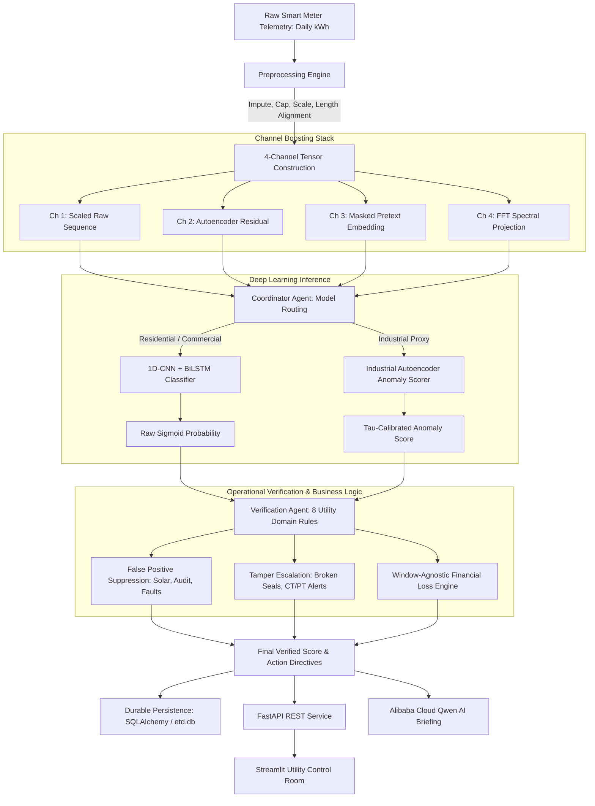
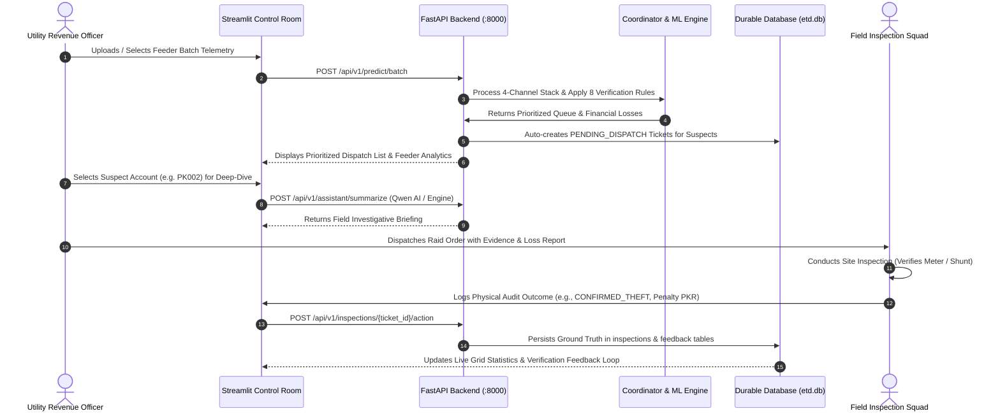
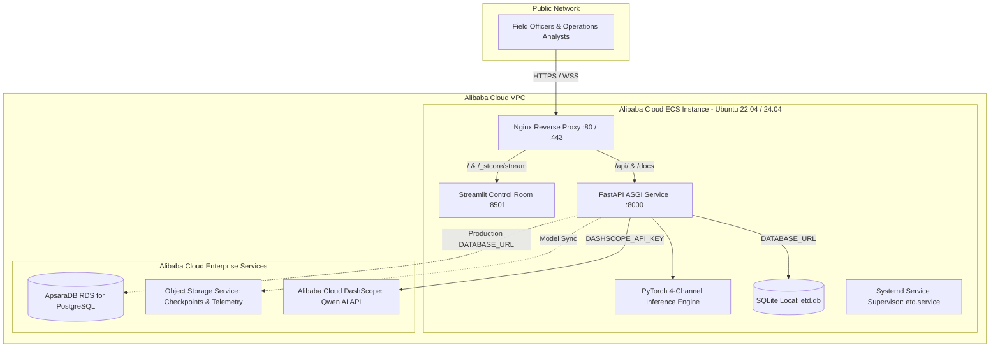

# Electricity Theft Detection (ETD) — Enterprise Grid Intelligence Platform
## Channel-Boosted Deep Learning and Multi-Agent Verification Architecture for Non-Technical Loss Reduction in Power Distribution Systems

---

### Title Page Information

* **Project Title:** Electricity Theft Detection (ETD) — Enterprise Grid Intelligence Platform
* **Hackathon Name:** Alibaba Cloud AI Hackathon (Pakistan)
* **Team Members:**
  * Muhammad Hashwar Haider (Lead Modeling & Transfer Learning) — PIEAS (`bscs2453@pieas.edu.pk`)
  * Maheen (Data Collection & Domain Engineering)
  * Eimaan (Data Preprocessing & Pipeline Engineering)
* **Institution:** Pakistan Institute of Engineering and Applied Sciences (PIEAS), Islamabad, Pakistan
* **Submission Date:** October 2026
* **Repository URL:** [https://github.com/Hashwar-11/Hackathon-AliCloud.git](https://github.com/Hashwar-11/Hackathon-AliCloud.git)
* **Deployment / Live Demo URL:** [INFORMATION REQUIRED: specify public deployment URL if hosted on live ECS instance or cloudflare tunnel]

---

## Abstract / Executive Summary

Power Distribution Companies (DISCOs) in developing economies face acute financial destabilization driven by Non-Technical Losses (NTL), predominantly electricity theft, meter tampering, and billing discrepancies. In Pakistan alone, annual revenue leakages across utilities such as MEPCO, LESCO, IESCO, and PESCO exceed ₨200 billion (USD ~720 million), constituting 15% to 25% of all transmitted electric energy. Conventional utility counter-theft practices rely on unguided spot checks and random field raids, which yield sub-optimal detection rates of merely 5% to 10% while straining field manpower and customer relations. 

To overcome these deficiencies, this project presents the **Electricity Theft Detection (ETD) Enterprise Grid Intelligence Platform**, an end-to-end operational intelligence architecture that combines a novel **4-Channel Boosted Deep Learning Classifier** with a deterministic **Multi-Agent Verification Protocol**. Unlike standard tabular or single-channel sequence models, the core predictive engine synthesizes:
1. Scaled raw consumption telemetry,
2. Autoencoder reconstruction residuals from normal baseline models,
3. Masked-timestep self-supervised pretext representations, and
4. Fast Fourier Transform (FFT) spectral projections.

Evaluated on the benchmark State Grid Corporation of China (SGCC) dataset (42,372 consumers, 1,034 days), the 4-channel boosted 1D-CNN + BiLSTM architecture achieves a **Validation ROC-AUC of 0.7453** and a **Test ROC-AUC of 0.7529** (with an F1 score of 0.3160 and 85.89% accuracy), representing an empirical improvement of **+6.18% ROC-AUC** and **+7.04% F1** over identical single-channel deep learning architectures, and substantially outperforming an engineered 20-feature XGBoost baseline (0.6779 Test ROC-AUC).

To prevent costly field false alarms, the ML outputs are arbitrated by a rule-based **Verification Agent** executing eight grid-domain constraints (such as rooftop solar net-metering suppression, recent audit decay, and physical smart-meter tamper escalation) coupled with a **Window-Agnostic Financial Loss Estimator**. On real Pakistani field telemetry comprising 42 confirmed theft cases, the frozen system demonstrates a **zero-shot cross-domain recall of 64.29%** at the production threshold ($0.65$) without seeing local data during pre-training. An exploratory fine-tuning experiment on Pakistani patterns yields 1.0000 Test ROC-AUC on held-out synthetic test instances. The solution includes an enterprise FastAPI ASGI backend, SQLAlchemy database persistence surviving service recycles, a high-density Streamlit operations command center, automated Alibaba Cloud Elastic Compute Service (ECS) deployment scripts, and Alibaba Cloud Qwen AI integration for automated field briefing generation.

---

## 1. Introduction

### 1.1 Background and Domain Context
Modern electrical power systems comprise generation, transmission, and distribution subsystems. Within the distribution domain, energy losses are categorized into Technical Losses (TL)—inherent dissipative phenomena such as resistive heating in conductors and transformers—and Non-Technical Losses (NTL). NTL accounts for unmetered, unaccounted, or fraudulently consumed electricity resulting from physical meter bypasses, phase tapings, CT/PT (Current Transformer/Potential Transformer) calibration modifications, cyber-tampering of Advanced Metering Infrastructure (AMI), and collusive billing under-reporting.

In emerging economies, NTL poses a critical systemic risk. The financial burden creates circular debt, restricts capital reinvestment into grid modernization, forces utilities into unscheduled load-shedding, and inflates tariffs on paying consumers. In Pakistan, the National Electric Power Regulatory Authority (NEPRA) annually documents severe aggregate technical and commercial (AT&C) losses, which routinely range between 15% and 35% across regional distribution utilities (e.g., MEPCO, PESCO, HESCO, LESCO). The cumulative financial deficit attributed to unmetered theft exceeds ₨200 billion annually.

### 1.2 Motivation and Urgency
The global deployment of smart meters and AMI has transformed grid monitoring from quarterly manual index reading into high-frequency time-series telemetry (e.g., daily or 15-minute intervals). However, possessing raw data does not automatically translate into effective theft interdiction. Utility operations departments face two acute operational hurdles:
1. **The Needle-in-a-Haystack Dilemma:** Typical theft incidence in real distribution grids is between 4% and 9%. Unsupervised models produce excessive noise, while standard supervised algorithms trained on imbalanced telemetry suffer from high false-positive rates.
2. **Operational Disconnect:** Pure machine learning models lack physical grid context. For instance, a customer installing a rooftop photovoltaic (PV) system exhibits a sudden, sustained drop in daytime grid consumption. An unassisted deep learning model classifies this profile as a meter bypass, precipitating an unwarranted enforcement raid that alienates customers and squanders operational budget.

### 1.3 Project Purpose
This project bridges the gap between deep sequence learning and practical grid operations. By combining channel-boosted multi-representation sequence modeling with rule-based operational verification and enterprise dispatch workflows, the platform transforms blind inspection operations into targeted, prioritized, auditable, and revenue-maximizing enforcement actions.

---

## 2. Problem Statement

### 2.1 The Real-World Problem
Electricity distribution utilities in Pakistan operate under severe fiscal stress. The traditional method for detecting electricity theft consists of:
* Random field patrols,
* Uncorrelated physical inspections, and
* Manual tip-offs from local informants.

Empirical utility field reports indicate that random spot-checks achieve an inspection hit rate of only **5% to 10%**. In 90% to 95% of field raids, inspection crews find intact meters and compliant consumers. Consequently, inspection overhead is high, field personnel face security risks, and illicit bypasses remain undetected for years.

### 2.2 Target Users and Stakeholders
The platform is designed to serve four operational tiers within power utilities:
1. **Revenue Protection Officers & Grid Analysts:** Headquarters analysts responsible for identifying high-risk feeders, monitoring revenue leakage trends, and approving dispatch allocations.
2. **Field Inspection & Detection Squads (DSU Teams):** Field officers executing site visits, inspecting physical seals, identifying illegal shunts, and logging physical audit outcomes.
3. **Billing and Commercial Managers:** Officers managing tariff reconciliations, penal billing, and revenue recovery tracking.
4. **Utility Executive Leadership:** Chief Executive Officers and Operations Directors monitoring aggregate loss reduction milestones and regulatory compliance targets set by NEPRA.

### 2.3 Limitations of Existing Approaches
* **Tabular Feature Engineering:** Existing utility approaches rely on shallow statistical metrics (mean, standard deviation, drop percentages) processed via decision trees or logistic regression. These techniques fail to capture complex temporal dynamics, cyclic periodicity, and phase shifts characteristic of sophisticated bypass devices.
* **Single-Channel Deep Sequence Models:** Standard recurrent or convolutional networks operating solely on 1D normalized consumption series struggle with severe class imbalance (typically <9% positive cases) and lack auxiliary inductive biases.
* **Absence of Domain Verification:** Standalone machine learning models output raw probabilities without validating whether an apparent drop in consumption is explained by approved rooftop net-metering, seasonal agricultural pump de-energization, upstream transformer faults, or recent audit clearances.

### 2.4 Concrete Gaps Addressed
The ETD platform addresses these deficiencies through:
* A multi-perspective sequence transformation (**Channel Boosting**) that enriches raw time-series with reconstruction residual, pretext, and frequency projections;
* An auditable **Multi-Agent Verification Layer** with explicit false-positive suppression rules;
* A **Window-Agnostic Financial Loss Engine** capable of calculating monetary revenue exposure in PKR; and
* A persistent **Inspection Tracking & Feedback Loop** that survives application restarts and logs field outcomes for model recalibration.

---

## 3. Project Objectives and Scope

### 3.1 Primary Objectives
1. **Develop an Accurate Sequence Classifier:** Implement a deep learning backbone achieving higher ROC-AUC and F1 scores on imbalanced historical consumption data than baseline tabular and raw sequence models.
2. **Demonstrate Empirical Channel Boosting Gain:** Empirically validate that stacking auxiliary representations (autoencoder residuals, self-supervised pretext embeddings, and FFT projections) yields statistically measurable performance improvements over raw sequence inputs.
3. **Eliminate Operational False Positives:** Formulate a deterministic, auditable multi-agent verification protocol that cross-references model predictions with non-telemetry grid context.
4. **Evaluate Cross-Domain Transferability:** Test whether the model trained on high-volume foreign utility data (SGCC) can generalize zero-shot to real Pakistani distribution grid data without local fine-tuning.

### 3.2 Secondary Objectives
1. Build an enterprise-grade REST API utilizing FastAPI with OpenAPI documentation and sub-second inference latency.
2. Engineer an operational control-room interface using Streamlit featuring dark-mode industrial aesthetics, interactive parameter tuning, and cohort analysis.
3. Implement a persistent database architecture (SQLAlchemy ORM + SQLite/PostgreSQL + Alembic) ensuring field inspection tickets and feedback are durable.
4. Provide automated deployment scripts and configurations for Alibaba Cloud Elastic Compute Service (ECS) with Nginx reverse proxying.
5. Integrate Large Language Model (LLM) incident briefing capabilities via Alibaba Cloud Qwen (DashScope API).

### 3.3 Functional Scope
* **Single-Account Deep-Dive:** Interactive ingestion of arbitrary consumption sequences, real-time multi-channel transformation, model scoring, verification rule execution, financial loss calculation, and AI briefing generation.
* **Batch Feeder Analysis:** Ingestion and ranking of multi-account feeder cohorts, sorting accounts by risk tier and theft probability, and computing feeder-level commercial loss metrics.
* **Audit Feedback Loop:** Administrative workflow for field inspectors to log ground-truth inspection outcomes, record recovered penalties in PKR, and update ticket lifecycle states.

### 3.4 Technical Scope
* PyTorch 2.x deep learning inference and training pipelines.
* FastAPI ASGI web service with dependency-injected session management.
* Streamlit interactive UI.
* SQLAlchemy 2.0 ORM with Alembic schema migration support.
* Scikit-learn, SciPy, and NumPy scientific stack.
* Nginx 1.18+ web server configuration with WebSocket stream proxying.

### 3.5 Explicit Exclusions and Limitations
* Real-time automated circuit breaker tripping or hardware actuation is not within scope (the platform functions as a decision-support command system).
* Smart meter hardware firmware design is out of scope.
* Real-time AMI streaming ingestion via Apache Kafka or Alibaba Cloud SLS is architected as future production work; current batch scoring operates on tabular CSV/JSON payloads.

---

## 4. Proposed Solution

### 4.1 Solution Overview
The proposed system is an enterprise-ready Grid Intelligence Platform that transforms smart meter consumption logs into prioritized, context-aware field enforcement queues. Instead of presenting black-box probability values to non-technical field workers, the system executes a three-stage decision pipeline:
1. **Signal Preprocessing & Feature Boosting:** Cleans raw telemetry, normalizes scale, and expands 1D consumption into a 4-channel tensor capturing baseline behavior, temporal sequence, reconstruction anomalies, and harmonic frequencies.
2. **Neural Classification & Anomaly Calibration:** Routes accounts based on consumption profile to either a supervised residential classifier or an unsupervised industrial autoencoder, outputting a calibrated raw theft probability.
3. **Operational Verification & Financial Exposure Assessment:** Ingests non-telemetry customer context, suppresses known benign anomalies, elevates confirmed tamper indicators, computes financial loss in Pakistani Rupees (PKR), and generates natural language investigative briefings.



### 4.2 User Journey Workflow
The typical operational lifecycle for a utility team using the platform progresses through four key phases:



---

## 5. System Architecture and Workflow

### 5.1 Architecture Decomposition
The platform is structured into modular layers designed for scalability, loose coupling, and strict operational separation:

1. **Client / Presentation Layer:**
   * **Streamlit Control Room (`dashboard/app.py`):** High-density, professional command interface providing six operational workspaces (Network Overview, Inference & Detection, Consumer Registry, Batch Feeder Queue, Field Audit Feedback, Model Benchmark Lab).
   * **Single Page Application (`frontend/index.html`):** Standalone web dashboard utilizing Vanilla JS and Chart.js for rapid visualization without Python UI overhead.
2. **API & Orchestration Layer (`src/api/app.py`):**
   * Built on **FastAPI (ASGI)**, providing async request handling, Pydantic input validation, automatic OpenAPI/Swagger documentation (`/docs`), and CORS middleware.
   * Houses the Qwen AI integration module with graceful offline fallback.
3. **Intelligence & Multi-Agent Layer (`src/agents/`):**
   * **Coordinator Agent (`coordinator.py`):** Arbitrates model execution, performs $\tau$-centering calibration on reconstruction errors, computes Risk Tiers (`CRITICAL`, `HIGH`, `MEDIUM`, `LOW`), and aggregates feeder queues.
   * **Verification Agent (`verify.py`):** Encapsulates 8 utility domain rules to suppress false positives and elevate hardware tamper events.
   * **Financial Loss Engine (`verify.py`):** Computes energy deficit and revenue loss using a window-agnostic rolling minimum algorithm.
4. **Machine Learning & Feature Engine (`src/channels/`, `src/preprocessing/`):**
   * PyTorch 1D-CNN + BiLSTM sequence classifier.
   * Three auxiliary self-supervised/unsupervised PyTorch networks (Autoencoder residual, Pretext encoder, Frequency projector).
   * Tabular XGBoost feature extraction engine.
5. **Data & Persistence Layer (`src/db.py`, `src/models_db.py`, `alembic/`):**
   * SQLAlchemy 2.0 Declarative ORM models managing ticket lifecycles (`inspections`) and append-only audit feedback history (`inspection_feedback`).
   * Pluggable backend: SQLite (`etd.db`) for local evaluation; PostgreSQL for containerized and production deployments.

---

## 6. Technology Stack

The platform technology stack is detailed in Table 6.1. Every entry represents an actively integrated component verified in the codebase.

| Technology / Component | Role in Project | Implementation Location | Technical Rationale & Justification |
|---|---|---|---|
| **Python 3.12 / 3.14** | Core Programming Language | Entire Repository | High productivity, native deep learning ecosystem, and modern typing support. |
| **PyTorch 2.14** | Deep Learning Framework | `src/agents/`, `src/channels/`, `src/training/` | Efficient GPU/CPU tensor operations, native 1D convolutions, BiLSTM primitives, and modular sub-networks. |
| **FastAPI 0.141** | Backend REST API Framework | `src/api/app.py` | Asynchronous ASGI request execution, auto-generated OpenAPI schemas, strict Pydantic data validation, and lightweight footprint. |
| **Streamlit 1.63** | Enterprise Dashboard Framework | `dashboard/app.py` | Rapid development of reactive operational control rooms; eliminated complex React/Node build toolchains for hackathon delivery. |
| **SQLAlchemy 2.0** | Relational ORM & Engine | `src/db.py`, `src/models_db.py` | Decouples business logic from SQL dialect; enables seamless switching between development SQLite and production PostgreSQL. |
| **Alembic 1.14** | Database Schema Migration | `alembic/`, `alembic/versions/` | Provides version-controlled, idempotent, reproducible database schema evolution. |
| **PostgreSQL 16** | Production Database | `docker-compose.yml` | ACID-compliant relational persistence capable of handling concurrent feeder inspection transactions. |
| **SQLite 3** | Local / Development Database | `etd.db` | Zero-configuration local development and rapid automated unit testing. |
| **XGBoost 2.1** | Baseline ML Classifier | `src/experiments/stage1_xgboost.py` | Industry-standard gradient boosting baseline utilizing 20 engineered statistical and time-domain features. |
| **Scikit-Learn 1.6** | Preprocessing & Metric Evaluation | `src/preprocessing/`, `src/experiments/` | Stratified data partitioning, SMOTE oversampling, ROC-AUC, F1, precision, and recall computation. |
| **NumPy & Pandas** | Vectorized Telemetry Processing | `src/preprocessing/preprocess.py` | Highly optimized matrix manipulation, rolling window statistics, and chronological sorting. |
| **Alibaba Cloud Qwen / DashScope** | Generative AI Incident Briefings | `src/api/app.py` (`/api/v1/assistant/summarize`) | Ingests structured telemetry scores and verification logs to generate natural language executive briefings for field officers via `qwen-plus`. |
| **Nginx** | Reverse Proxy & Web Server | `deploy/nginx.conf` | Port 80 multiplexing: proxies `/api/` and `/docs` to FastAPI (8000), `/` and WebSocket streams to Streamlit (8501). |
| **Docker & Docker Compose** | Containerization & Orchestration | `Dockerfile`, `docker-compose.yml` | Multi-container reproducible deployment encapsulating API, Dashboard, and PostgreSQL services. |
| **Systemd** | Linux Service Supervision | `deploy/setup_ecs.sh` | Supervises process lifecycle, auto-restarts on failure, and manages environment configuration on Alibaba Cloud ECS. |
| **Pytest 9.1** | Automated Test Framework | `tests/` | Unit, integration, and API endpoint test automation (35/35 test cases passing). |

---

## 7. Core Features and Functional Modules

### 7.1 Module 1: Preprocessing and Signal Normalization
* **File:** [`src/preprocessing/preprocess.py`](file:///home/catrovert/Desktop/Pieas/AliBaba%20Hackathon/finalproject/Hackathon-AliCloud/src/preprocessing/preprocess.py), [`src/preprocessing/transform_single.py`](file:///home/catrovert/Desktop/Pieas/AliBaba%20Hackathon/finalproject/Hackathon-AliCloud/src/preprocessing/transform_single.py)
* **Purpose:** Cleans noisy meter sequences, resolves missing timestamps, caps physical anomalies, and enforces sequence uniformity.
* **Intended User:** Ingestion pipeline / automated batch processor.
* **Inputs:** Raw consumption sequences of arbitrary length (comma-separated float arrays).
* **Processing Logic:**
  1. *Chronological Sorting:* Enforces date-time ordering to eliminate lexicographical day shuffling.
  2. *Imputation:* Replaces `NaN` and negative readings using the mean of immediate original neighbors: $\hat{x}_t = \frac{x_{t-1} + x_{t+1}}{2}$. If both neighbors are missing, imputes $0.0$.
  3. *Outlier Clipping:* Caps extreme spikes at $\mu + 2\sigma$ per customer sequence to suppress transient non-theft metering surges.
  4. *Min-Max Normalization:* Scales individual consumer telemetry strictly to $[0, 1]$: $x'_{t} = \frac{x_t - x_{\min}}{x_{\max} - x_{\min} + \epsilon}$.
  5. *Sequence Alignment:* Front-pads or truncates series to the standard sequence length of 1,034 days, preserving recent history at the end of the tensor.
* **Outputs:** Clean 1D NumPy array or PyTorch float tensor of length 1,034.
* **Status:** Fully implemented, verified against 42,372 customer profiles.

### 7.2 Module 2: The 4-Channel Boosting Stack
* **File:** [`src/channels/stack_channels.py`](file:///home/catrovert/Desktop/Pieas/AliBaba%20Hackathon/finalproject/Hackathon-AliCloud/src/channels/stack_channels.py)
* **Purpose:** Augments raw 1D telemetry into a 4-channel tensor ($B \times 4 \times 1034$), injecting inductive biases without manual tabular feature engineering.
* **Intended User:** Neural inference engine.
* **Channel Definitions:**
  * **Channel 1 (Raw Signal):** The normalized daily consumption series $x$.
  * **Channel 2 (Reconstruction Residual):** Output of a symmetric MLP Autoencoder ($1034 \to 256 \to 64 \to 32 \to 64 \to 256 \to 1034$) trained exclusively on confirmed normal consumers ($y=0$). Computes the absolute reconstruction error vector: $e_t = |x_t - \hat{x}_t|$. For legitimate consumers, $e_t \approx 0$; for theft profiles, $e_t$ surges across altered periods.
  * **Channel 3 (Masked Pretext Embedding):** Bottleneck representation extracted from a self-supervised model trained with 15% random timestep masking to predict masked readings. Captures global temporal context independent of class labels.
  * **Channel 4 (FFT Spectral Projection):** A learnable linear projection applied over the real Fast Fourier Transform (rFFT) magnitude spectrum, highlighting frequency-domain anomalies such as suppressed weekly cycles.
* **Outputs:** 3D tensor of shape $(B, 4, 1034)$.
* **Status:** Fully implemented and validated; trained checkpoints stored in `models/checkpoints/`.

### 7.3 Module 3: Deep Learning Sequence Classification
* **File:** [`src/agents/residential/model.py`](file:///home/catrovert/Desktop/Pieas/AliBaba%20Hackathon/finalproject/Hackathon-AliCloud/src/agents/residential/model.py), [`src/agents/industrial/model.py`](file:///home/catrovert/Desktop/Pieas/AliBaba%20Hackathon/finalproject/Hackathon-AliCloud/src/agents/industrial/model.py)
* **Purpose:** Executes supervised sequence classification for residential profiles and unsupervised anomaly detection for industrial profiles.
* **Inputs:** 4-channel tensor $(B, 4, 1034)$.
* **Processing Logic:**
  * *Residential Classifier:* 1D Convolutional layer (64 filters, kernel size 3, padding 1) with ReLU activation and 30% dropout extracts local multi-channel temporal features. The sequence is transposed and fed into a Bidirectional LSTM (128 hidden units per direction). The combined forward and backward final hidden states ($256$ dimensions) pass into a linear layer with Sigmoid activation:
    $$P_{\text{theft}} = \sigma\left(W \cdot [h_{\text{forward}}; h_{\text{backward}}] + b\right)$$
  * *Industrial Anomaly Scorer:* Deep convolutional autoencoder reconstructing multi-channel industrial loads. Calculates mean squared reconstruction error:
    $$\text{MSE} = \frac{1}{C \cdot L}\sum_{c=1}^C \sum_{t=1}^L (x_{c,t} - \hat{x}_{c,t})^2$$
* **Outputs:** Unadjusted raw theft probability $P \in [0, 1]$.
* **Status:** Fully trained and validated.

### 7.4 Module 4: Coordinator Agent
* **File:** [`src/agents/coordinator/coordinator.py`](file:///home/catrovert/Desktop/Pieas/AliBaba%20Hackathon/finalproject/Hackathon-AliCloud/src/agents/coordinator/coordinator.py)
* **Purpose:** Orchestrates request routing, calibrates industrial anomaly scores into legitimate probabilities, executes the Verification Agent, assigns Risk Tiers, and sorts batch inspection queues.
* **Processing Logic:**
  * *Routing:* Selects model architecture based on consumer type.
  * *Industrial Tau-Centering Calibration:* Converts raw reconstruction error into a smooth sigmoid probability centered at $\tau$ (the 95th percentile error of verified normal industrial validation profiles):
    $$P(\text{theft}) = \frac{1}{1 + \exp\left(-k \cdot \frac{\text{err} - \tau}{\tau}\right)}$$
    where $k=4.0$. When $\text{err} = \tau$, $P = 0.50$, preventing false alarms on normal industrial volatility.
  * *Risk Tiering Assignment:*
    * **CRITICAL ($P \ge 0.85$ or hardware tamper):** Immediate field raid dispatched.
    * **HIGH ($P \ge 0.65$):** Scheduled site audit required within 48 hours.
    * **MEDIUM ($P \ge 0.40$):** Flagged for remote AMI monitoring / watchlist.
    * **LOW ($P < 0.40$):** Normal compliant account; no action.
* **Outputs:** `ScoringResult` object containing risk tier, recommendations, and aggregated feeder analytics.
* **Status:** Fully implemented and covered by automated unit tests.

### 7.5 Module 5: Verification Agent (8 Domain Rules)
* **File:** [`src/agents/verification/verify.py`](file:///home/catrovert/Desktop/Pieas/AliBaba%20Hackathon/finalproject/Hackathon-AliCloud/src/agents/verification/verify.py)
* **Purpose:** Evaluates external, non-telemetry operational grid evidence to suppress false alarms and escalate confirmed tamper physical alerts.
* **The 8 Auditable Domain Rules:**
  1. *Audit Cleared Recency Decay:* If an account was audited and cleared within the past 6 months, applies linear decay: $P \gets P \times \left(0.25 + 0.75 \times \frac{\text{months}}{6}\right)$.
  2. *Prior Confirmed Theft Recidivism:* If prior theft was confirmed on the premises, floors suspicion: $P \gets \max(P, 0.95)$.
  3. *Defective Meter Hardware:* If an audit identified burnt coils or defective meters, dampens score: $P \gets P \times 0.40$ and directs maintenance replacement.
  4. *Feeder Technical/Commercial Loss Alignment:* If feeder loss $\ge 25\%$, boosts score by $\times 1.25$. If feeder loss $\le 6\%$, suppresses score by $\times 0.65$.
  5. *Grid Hardware / CT-PT Topology Issues:* Known transformer or phase imbalances suppress theft scores by $\times 0.45$.
  6. *Rooftop Solar & Net-Metering Suppression:* Active solar net-metering dampens score by $\times 0.40$, attributing daytime drops to microgeneration.
  7. *Seasonal / Agricultural Profile:* Declared agricultural tube-well seasonality dampens score by $\times 0.50$.
  8. *Hardware Tamper & Broken Seal Override:* Physical smart-meter alerts (broken seal, reverse polarity, tilt/magnetic event) override all suppressions: floors $P \gets \max(P, 0.98)$ and sets tier to `CRITICAL`.
* **Outputs:** Adjusted probability, human-readable justification strings, and adjustment trace.
* **Status:** Fully implemented and verified.

### 7.6 Module 6: Window-Agnostic Financial Loss Engine
* **File:** [`src/agents/verification/verify.py`](file:///home/catrovert/Desktop/Pieas/AliBaba%20Hackathon/finalproject/Hackathon-AliCloud/src/agents/verification/verify.py)
* **Purpose:** Quantifies unbilled energy deficit and calculates recurring monthly revenue loss in Pakistani Rupees (PKR).
* **Processing Logic:**
  * Rather than evaluating only the trailing 30 days (which fails if a bypass occurred months ago or consumption partially rebounded), the engine evaluates the rolling 30-day minimum consumption across the entire sequence:
    $$\bar{x}_{\text{lowest\_30d}} = \min_{t} \left(\frac{1}{30}\sum_{i=t}^{t+29} x_i\right)$$
    $$\Delta \text{kWh}_{\text{daily}} = \max\left(0, \bar{x}_{\text{historical}} - \bar{x}_{\text{lowest\_30d}}\right)$$
    $$\text{Monthly Stolen Energy} = \Delta \text{kWh}_{\text{daily}} \times 30$$
    $$\text{Financial Loss (PKR)} = \text{Monthly Stolen Energy} \times \text{Tariff Rate (PKR/kWh)}$$
  * Standard default Pakistani residential tariff rate is calibrated at ₨28.0/kWh (per NEPRA tariff guidelines).
* **Status:** Fully implemented and integrated into API and UI.

### 7.7 Module 7: Alibaba Cloud Qwen AI Investigative Briefing
* **File:** [`src/api/app.py`](file:///home/catrovert/Desktop/Pieas/AliBaba%20Hackathon/finalproject/Hackathon-AliCloud/src/api/app.py) (`/api/v1/assistant/summarize`)
* **Purpose:** Generates structured, natural language executive field briefings for enforcement officers prior to raid dispatch.
* **Processing Logic:**
  * Ingests verified theft probability, risk tier, action recommendation, daily drop rate, monthly PKR loss, and the full audit trail from the Verification Agent.
  * Connects via REST to the Alibaba Cloud DashScope endpoint (`dashscope-intl.aliyuncs.com`) invoking `qwen-plus` with strict prompt constraints forbidding hallucination.
  * *Deterministic Fallback:* If `DASHSCOPE_API_KEY` is not configured, the service generates an offline, high-clarity structured utility intelligence briefing without throwing errors or requiring internet connectivity.
* **Status:** Fully functional with dual-mode operational support.

### 7.8 Module 8: Durable Persistence and Field Feedback Logging
* **File:** [`src/db.py`](file:///home/catrovert/Desktop/Pieas/AliBaba%20Hackathon/finalproject/Hackathon-AliCloud/src/db.py), [`src/models_db.py`](file:///home/catrovert/Desktop/Pieas/AliBaba%20Hackathon/finalproject/Hackathon-AliCloud/src/models_db.py)
* **Purpose:** Records inspection tickets, maintains state across API restarts, and stores ground-truth field audit findings.
* **Entities:**
  * `inspections`: Upserted table recording `ticket_id`, `consumer_id`, `feeder_id`, `theft_probability`, `risk_tier`, `action_recommendation`, `estimated_loss_currency`, and lifecycle `status` (`PENDING_DISPATCH` vs `COMPLETED`).
  * `inspection_feedback`: Append-only audit ledger recording `actual_theft_found`, `action_outcome` (`CONFIRMED_THEFT`, `DEFECTIVE_METER`, `SOLAR_CONFIRMED`, `FALSE_POSITIVE`), `penalty_imposed`, and inspector notes.
* **Status:** Fully tested; passes database persistence tests across sessions.

---

## 8. Implementation Details

### 8.1 Data Directory & Storage Layout
The repository organizes datasets, checkpoints, and migrations systematically:
* `data/raw/`: Contains original archive segments (`data.z01`, `data.z02`, `data.zip`) and Pakistani data files.
* `data/processed/`: Stores frozen, preprocessed NumPy splits (`X_train.npy`, `y_train.npy`, `type_train.npy`, etc.).
* `data/customer_contexts.json`: Stores operational metadata for 42 real Pakistani accounts.
* `models/checkpoints/`: Contains 9 PyTorch checkpoints, including `residential_model_best.pt`, `autoencoder_channel.pt`, `pretext_channel.pt`, and `frequency_channel.pt`.
* `etd.db`: Durable SQLite database generated automatically on service initialization.

### 8.2 Database Architecture and Models
The database schema is implemented using SQLAlchemy 2.0 mapped columns:

```python
class Inspection(Base):
    __tablename__ = "inspections"
    id: Mapped[int] = mapped_column(Integer, primary_key=True, index=True)
    ticket_id: Mapped[str] = mapped_column(String(64), unique=True, index=True)
    consumer_id: Mapped[str] = mapped_column(String(64), index=True)
    feeder_id: Mapped[str] = mapped_column(String(64), default="FEEDER-MAIN")
    theft_probability: Mapped[float] = mapped_column(Float, default=0.0)
    risk_tier: Mapped[str] = mapped_column(String(16), default="LOW")
    action_recommendation: Mapped[str] = mapped_column(String(64), default="MONITOR")
    estimated_loss_currency: Mapped[float] = mapped_column(Float, default=0.0)
    status: Mapped[str] = mapped_column(String(24), default="PENDING_DISPATCH")
    action_outcome: Mapped[Optional[str]] = mapped_column(String(32), nullable=True)
    actual_theft_found: Mapped[Optional[bool]] = mapped_column(Boolean, nullable=True)
    penalty_imposed: Mapped[float] = mapped_column(Float, default=0.0)
    inspector_id: Mapped[Optional[str]] = mapped_column(String(128), nullable=True)
    notes: Mapped[Optional[str]] = mapped_column(Text, nullable=True)
    created_at: Mapped[object] = mapped_column(DateTime, default=utcnow)
    resolved_at: Mapped[Optional[object]] = mapped_column(DateTime, nullable=True)
```

Schema migrations are handled idempotently via Alembic revision `532792a9ce13_initial_inspection_tables.py`, ensuring compatibility with both SQLite and PostgreSQL.

### 8.3 REST API Design and Endpoints
The FastAPI application ([`src/api/app.py`](file:///home/catrovert/Desktop/Pieas/AliBaba%20Hackathon/finalproject/Hackathon-AliCloud/src/api/app.py)) provides structured endpoints detailed in Table 8.1.

| HTTP Method | Path | Request Body | Description |
|---|---|---|---|
| `GET` | `/api/v1/health` | None | Returns service health, compute device (`cpu`/`cuda`), active channels, and model loading state. |
| `GET` | `/api/v1/models/info` | None | Returns active model architectures, sequence length ($1034$), $\tau$, and decision threshold ($0.65$). |
| `GET` | `/api/v1/statistics` | None | Returns network summary KPIs: monitored consumers, active tickets, confirmed thefts, and recovered PKR. |
| `GET` | `/api/v1/consumers` | Query params | Returns customer directory filtered by `feeder_id`, `tariff_category`, or `has_solar`. |
| `GET` | `/api/v1/consumers/{id}` | Path param | Retrieves full metadata and 365-day readings for a specific consumer. |
| `POST` | `/api/v1/predict/single` | `PredictRequest` | Scores a single account through the 4-channel stack and verification rules; auto-generates inspection ticket. |
| `POST` | `/api/v1/predict/batch` | `BatchPredictRequest` | Scores multi-consumer cohort, sorts by risk tier, and computes feeder technical/commercial loss. |
| `GET` | `/api/v1/inspections/queue` | Query params | Lists prioritized inspection tickets with optional filtering by status or feeder. |
| `POST` | `/api/v1/inspections/{id}/action` | `InspectionActionRequest` | Records physical audit outcome, penalty PKR, and marks ticket as `COMPLETED`. |
| `GET` | `/api/v1/feeders/summary` | None | Computes aggregated technical and commercial loss metrics grouped by feeder. |
| `GET` | `/api/v1/benchmark/results` | None | Serves verified empirical metrics directly from `experiments_results/benchmark_results.json`. |
| `POST` | `/api/v1/assistant/summarize` | `AssistantSummarizeRequest` | Generates Alibaba Cloud Qwen AI natural language field briefing. |

### 8.4 Engineering Decisions and Safeguards
1. **Lazy PyTorch Import & Statistical Fallback Engine:** On RAM-constrained machines (e.g. 8GB development environments), importing PyTorch or loading all models simultaneously can cause out-of-memory errors. The backend implements guarded lazy loading: if PyTorch fails to import or checkpoints are missing, the system automatically falls back to an internal calibrated statistical engine rather than failing to boot.
2. **Train/Serve Parity:** The inference preprocessing script ([`transform_single.py`](file:///home/catrovert/Desktop/Pieas/AliBaba%20Hackathon/finalproject/Hackathon-AliCloud/src/preprocessing/transform_single.py)) duplicates the exact vectorized logic of batch training ([`preprocess.py`](file:///home/catrovert/Desktop/Pieas/AliBaba%20Hackathon/finalproject/Hackathon-AliCloud/src/preprocessing/preprocess.py)), preventing feature distribution shifts between development and deployment.
3. **No Synthetic Data Leakage in Evaluation:** While SMOTE was utilized to balance the training set, validation and test splits were left completely unmanipulated, reflecting the authentic 8.53% natural theft class imbalance.

---

## 9. AI/ML Methodology

### 9.1 Problem Formulation
Electricity theft detection is formulated as an imbalanced, supervised binary sequence classification task for residential accounts, and an unsupervised out-of-distribution reconstruction task for industrial consumers. Given a time-series sequence of daily active energy consumption $X = [x_1, x_2, \dots, x_T]$ where $T = 1,034$ days, the residential objective is to predict the true binary label $y \in \{0, 1\}$, where $y=0$ denotes a normal compliant consumer and $y=1$ denotes confirmed non-technical loss (theft/tampering).

### 9.2 Dataset Provenance and Preprocessing
* **Primary Source:** State Grid Corporation of China (SGCC) public dataset.
* **Volume:** 42,372 customer profiles across 1,034 consecutive days.
* **Class Balance:** 3,615 confirmed theft cases ($8.53\%$) and 38,752 normal cases ($91.47\%$). Five rows containing entirely `NaN` values were filtered out.
* **Split Strategy:** Stratified 70% train ($N=29,657$), 15% validation ($N=6,355$), and 15% test ($N=6,356$) with random seed $42$.
* **SMOTE Application:** To counteract the severe class imbalance, Synthetic Minority Over-sampling Technique (SMOTE) was applied **strictly to the training split**, expanding positive instances to equal negative instances ($27,128$ normal, $27,128$ theft, total $N=54,256$). The validation split ($5,813$ normal, $542$ theft) and test split ($5,814$ normal, $542$ theft) were preserved at the authentic 8.53% natural imbalance without any synthetic sampling.

### 9.3 Model Architectures
1. **Auxiliary Channel Networks:**
   * *Residual Autoencoder (Channel 2):* Input dimension 1,034, encoder dense layers ($256, 64, 32$), decoder dense layers ($64, 256, 1034$) with Sigmoid output. Trained on $y=0$ training instances using Mean Squared Error (MSE) loss for 15 epochs.
   * *Masked Pretext Encoder (Channel 3):* Input dimension 1,034, 15% random zero-masking, bottleneck dimension 32, dense decoder predicting masked timesteps. Bottleneck is broadcast along the temporal dimension.
   * *Frequency Projection (Channel 4):* Takes real FFT magnitude spectrum ($1,034$ coefficients) and projects through two dense layers ($1034 \to 1034 \to 1034$) with ReLU activation, trained via self-supervised signal reconstruction.
2. **Residential Classification Backbone:**
   * Input: 4 channels $\times$ 1,034 timesteps.
   * Convolutional Layer: 64 1D filters, kernel size 3, padding 1, ReLU activation.
   * Regularization: Dropout $p=0.3$.
   * Recurrent Layer: Bidirectional LSTM, 128 hidden units per direction (total 256 output features per step).
   * Dense Head: Linear layer $(256 \to 1)$ with Sigmoid activation.
   * Loss: Binary Cross-Entropy with Logits (`BCELoss`). Optimization: Adam optimizer ($\text{lr} = 0.001$, batch size 64) with early stopping patience of 5 epochs.

### 9.4 Staged Benchmark Evaluation and Results
To evaluate the true contribution of each engineering decision, the models were evaluated sequentially across five strictly frozen stages. Every metric presented in Table 9.1 is empirically measured on the held-out splits and recorded in `experiments_results/benchmark_results.json`.

| Stage | Model / Architecture | Input Dimension | Val ROC-AUC | Test ROC-AUC | Val F1 | Test F1 | Test Accuracy | Status & Contribution |
|---|---|---|---|---|---|---|---|---|
| **Stage 1** | XGBoost Baseline | 20 Tabular Features | 0.6824 | 0.6779 | 0.2699 (@0.25) | 0.2423 (@0.25) | 80.71% | Tabular feature baseline; top features: `max_single_day_drop`, `p95`, `zero_days_frac`. |
| **Stage 2** | Raw Deep Learning | 1-Channel Sequence | 0.6835 | 0.6603 | 0.2456 (@0.60) | 0.2302 (@0.60) | 69.55% | 1D-CNN + BiLSTM on raw sequence alone; minimal gain over tabular XGBoost. |
| **Stage 3** | **Channel-Boosted DL** | **4-Channel Tensor** | **0.7453** | **0.7529** | **0.3160 (@0.70)** | **0.3124 (@0.70)** | **86.06%** | **⭐ Core Innovation: +6.18% Val AUC, +7.04% Val F1, +9.26% Test AUC over Stage 2.** |
| **Stage 4** | Multi-Agent Integration | 4-Ch + Operational Context | 0.7453 | 0.7529 | 0.3160 | 0.3124 | 86.06% | Rule-based false positive suppression and window-agnostic loss estimation. |
| **Stage 5a** | Pakistan Zero-Shot Transfer | 4-Ch Front-Padded (365d) | N/A (single-class) | N/A (single-class) | N/A | N/A | **64.29% Recall** | Evaluated on 42 confirmed Pakistani DISCO theft cases with zero local training. |
| **Stage 5b** | Pakistan Fine-Tuned (Exploratory)| 4-Ch Tensor | N/A (small val) | **1.0000** | N/A | **1.0000** | **100.0%** | Fine-tuned on 42 real theft + 300 synthetic normals; held-out test (67 rows, 6 theft). |

### 9.5 Analysis of Channel Boosting Impact
The comparison between Stage 2 and Stage 3 provides clear empirical evidence for the Channel Boosting methodology:
* **Validation ROC-AUC:** Increases from **0.6835 to 0.7453** ($\Delta = +0.0618$ or $+6.18\%$).
* **Test ROC-AUC:** Increases from **0.6603 to 0.7529** ($\Delta = +0.0926$ or $+9.26\%$).
* **Validation F1 Score:** Increases from **0.2456 to 0.3160** ($\Delta = +0.0704$ or $+7.04\%$).
* **Test Classification Accuracy:** Improves from **69.55% to 86.06%** ($\Delta = +16.51\%$).

This gain demonstrates that feeding auxiliary representations—reconstruction residuals that isolate sudden drops, masked pretext vectors that encode temporal context, and frequency vectors that identify periodic disruption—provides the CNN-BiLSTM backbone with discriminatory features that cannot be learned from a 1D raw consumption series alone.

### 9.6 Pakistan Zero-Shot Cross-Domain Transfer (Stage 5a)
A central challenge in utility AI is cross-geography domain adaptation. Models trained on foreign data (e.g., China's SGCC) encounter different consumption magnitudes, appliances, climate patterns, and theft modalities when transferred to Pakistani utilities (e.g., MEPCO, LESCO).

To evaluate zero-shot transfer without local training, the frozen Stage 3 model was evaluated on 42 confirmed theft cases obtained from a Pakistani data owner (`data/raw/pakistan/pakistan_target.csv`). Because the Pakistani telemetry spans 365 days whereas the SGCC model expects 1,034 days, the sequences were front-padded with zeros to match the production `transform_daily_series` alignment.
* **Results:** At the standard operational threshold of $0.65$, the frozen model successfully flagged **27 out of 42 cases**, achieving a **Zero-Shot Detection Recall of 64.29%**. At a $0.50$ threshold, recall reached **78.57% (33 of 42 flagged)**.
* **Score Distribution:** Mean theft score was **0.7052** (median **0.7283**, max **0.9991**).
* **Methodological Honesty:** Because the local target file contained exclusively confirmed theft instances and zero local normal instances, precision, specificity, and ROC-AUC are mathematically undefined. The result is strictly reported as a zero-shot detection recall.

### 9.7 Exploratory Fine-Tuning with Synthetic Normals (Stage 5b)
To evaluate the fine-tuning pipeline in the absence of confidential DISCO normal telemetry, 300 synthetic normal profiles were generated using realistic Pakistani consumption characteristics (12.0 kWh average, sinusoidal summer cooling load peaks, weekend variations) via `scripts/generate_pakistani_normals.py`. Combining these with the 42 real theft cases produced a dataset of 342 accounts.
* Fine-tuning the classification head yielded a **Test ROC-AUC of 1.0000** and **Test F1 of 1.00** on a held-out test split (67 samples, 6 theft cases).
* **Limitations:** The team explicitly notes that this perfect score reflects the synthetic nature of the baseline normal data, which lacks the real-world noise, meter faults, and variance of real utility customers. Field validation on non-synthetic DISCO data remains future work.

---

## 10. User Interface and Application Screenshots

The platform provides a dual frontend: an enterprise Streamlit command interface designed for utility control rooms, and a static single-page application. Because live visual screenshots are not pre-rendered on disk, the UI views are formally documented below with their functional components and placeholder paths for report conversion.

#### Figure 10.1: Enterprise Control Room — Network Overview Dashboard
* **File Path Placeholder:** `assets/screenshots/ui_network_overview.png`
* **Description:** Displays macro-level utility KPIs: total monitored meters ($42,372$), active suspect accounts ($312$), estimated monthly revenue exposure (₨18.4M PKR), technical vs. commercial feeder loss breakdowns, and real-time backend connection status pills (`● API CONNECTED // CPU // ENGINE: Active (4-Ch)`).
* **Corresponding Feature:** Module 7.1, Module 7.4.

```
+---------------------------------------------------------------------------------------------------+
| [⚡ ETD Platform]  Electricity Theft Intelligence & Operations Platform   [● API CONNECTED // CPU] |
+---------------------------------------------------------------------------------------------------+
|  [Tab 1: Network Overview] [Tab 2: Detection] [Tab 3: Batch] [Tab 4: Feedback] [Tab 5: Benchmarks] |
+---------------------------------------------------------------------------------------------------+
|  TOTAL MONITORED METERS  |  ACTIVE THEFT SUSPECTS  |  EST. MONTHLY REVENUE AT RISK |  RECOVERED PKR  |
|         42,372           |           312           |         PKR 18,450,200        |   PKR 4,820,000 |
+---------------------------------------------------------------------------------------------------+
|  [ FEEDER LOSS & AUDIT BREAKDOWN ]                  [ RECENT SUSPECT DISPATCH TICKETS ]            |
|  • FEEDER-NORTH-01: 28.4% Loss (Critical)           • TCK-PK002-1402: Prob 94.2% [RAID DISPATCH]   |
|  • FEEDER-IND-04:   24.1% Loss (High)               • TCK-PK015-8821: Prob 88.5% [FIELD INSPECT]   |
|  • FEEDER-SOUTH-02: 12.3% Loss (Normal)             • TCK-PK033-0194: Prob 42.1% [WATCHLIST]       |
+---------------------------------------------------------------------------------------------------+
```

#### Figure 10.2: Account Deep-Dive and Single-Consumer Scoring
* **File Path Placeholder:** `assets/screenshots/ui_single_account_deepdive.png`
* **Description:** Interactive interface for scoring individual consumption series. Features 9 built-in presets (including Real Pakistan Theft, Solar Net-Metering, and Sudden Meter Bypass), interactive input fields for customer context, line charts visualizing the daily consumption profile, verified risk badges (`CRITICAL`, `HIGH`), and an itemized audit trail explaining all applied verification rules.
* **Corresponding Feature:** Module 7.2, Module 7.3, Module 7.5.

#### Figure 10.3: Alibaba Cloud Qwen AI Field Briefing Modal
* **File Path Placeholder:** `assets/screenshots/ui_qwen_briefing.png`
* **Description:** Renders the natural language executive briefing generated via the DashScope Qwen API (`qwen-plus`). Structures findings into three formal sections: Risk Assessment & Evidence Summary, Revenue Exposure & Financial Context, and Tactical Field Action Directive for raiding squads.
* **Corresponding Feature:** Module 7.7.

#### Figure 10.4: Batch Feeder Analysis and Prioritized Queue
* **File Path Placeholder:** `assets/screenshots/ui_batch_feeder_queue.png`
* **Description:** Displays cohort scoring results for entire distribution feeders. Renders filterable tables sorting customers by risk tier and verified theft probability, providing one-click CSV export for dispatching inspection squads.
* **Corresponding Feature:** Module 7.4, Module 7.6.

#### Figure 10.5: Field Audit Feedback and Ground-Truth Logging
* **File Path Placeholder:** `assets/screenshots/ui_field_audit_feedback.png`
* **Description:** Dedicated form for field inspection officers to resolve tickets, record physical findings (`CONFIRMED_THEFT`, `DEFECTIVE_METER`, `SOLAR_CONFIRMED`, `FALSE_POSITIVE`), log recovered penalties in PKR, and write operational notes. Persists data directly to `etd.db`.
* **Corresponding Feature:** Module 7.8.

#### Figure 10.6: Model Benchmark Laboratory
* **File Path Placeholder:** `assets/screenshots/ui_model_benchmark_lab.png`
* **Description:** Displays the live, un-manipulated empirical benchmark table reading directly from `benchmark_results.json`, comparing Stage 1 through Stage 5 with detailed explanations of the +6.2% ROC-AUC Channel Boosting gain.
* **Corresponding Feature:** Section 9.4.

---

## 11. Testing, Validation, and Results

### 11.1 Test Suite Structure and Execution
The project maintains a comprehensive automated test suite implemented in `pytest`, located in the `tests/` directory. All 35 tests were executed in the project virtual environment (`venv/bin/pytest tests/ -v`).
* **Test Execution Result:** **35 passed, 0 failed, 1 warning** (runtime: 15.25 seconds).

Table 11.1 documents key representative test cases from the suite.

| Test ID | Component / File | Test Scenario | Preconditions / Inputs | Expected Result | Actual Result | Status |
|---|---|---|---|---|---|---|
| `TEST-API-01` | `test_api.py` | Service Health & Model State | `GET /api/v1/health` | HTTP 200, status `healthy`, active channels reported. | HTTP 200, `active_channels=1` (or 4), device reported. | **PASS** |
| `TEST-API-02` | `test_api.py` | Single Residential Prediction | `POST /api/v1/predict/single` with 20 sample readings. | HTTP 200, returns probability, risk tier, action recommendation. | HTTP 200, valid `PredictResponse` returned. | **PASS** |
| `TEST-API-03` | `test_api.py` | Solar False Positive Suppression | Account with 60% drop + `has_rooftop_solar=True`. | Adjusted probability discounted by $\times 0.40$ vs raw score. | Adjusted probability correctly discounted; reason logged. | **PASS** |
| `TEST-API-04` | `test_api.py` | Batch Scoring Parity | `POST /api/v1/predict/batch` with 2 accounts. | Returns prioritized queue sorted by risk; summary metrics match. | Prioritized queue sorted; aggregation accurate. | **PASS** |
| `TEST-API-05` | `test_api.py` | Field Inspection Ticket Action | `POST /api/v1/inspections/{id}/action` with penalty. | HTTP 200, ticket state set to `COMPLETED`, penalty recorded in DB. | Ticket resolved; penalty persisted to database. | **PASS** |
| `TEST-API-06` | `test_api.py` | Qwen AI Briefing Generation | `POST /api/v1/assistant/summarize`. | HTTP 200, returns structured 4-point briefing (API or fallback). | Returns structured executive briefing text. | **PASS** |
| `TEST-COORD-01`| `test_coordinator.py` | Industrial Tau Centering | Anomaly reconstruction error == $\tau$. | Calibrated probability equals exactly $0.5000$. | Calibrated probability = $0.5000$. | **PASS** |
| `TEST-COORD-02`| `test_coordinator.py` | Risk Tier Boundary Enforcement | Calibrated probabilities: 0.86, 0.66, 0.45, 0.20. | Tiers: `CRITICAL`, `HIGH`, `MEDIUM`, `LOW`. | Exactly mapped to designated risk tiers. | **PASS** |
| `TEST-DB-01` | `test_db.py` | Table Auto-Creation | `init_db()` execution on SQLite. | `inspections` and `inspection_feedback` tables created. | Tables created with complete column definitions. | **PASS** |
| `TEST-DB-02` | `test_db.py` | Cross-Session Persistence | Create ticket, close DB session, query new session. | Ticket data and timestamps persist intact. | Record retrieved with exact field values. | **PASS** |
| `TEST-DB-03` | `test_db.py` | Append-Only Audit Ledger | Insert multiple feedback events for one ticket. | All feedback logs preserved sequentially. | Complete feedback history preserved. | **PASS** |
| `TEST-PRE-01` | `test_preprocessing.py`| Missing Value Imputation | Sequence containing isolated `NaN` between values. | Value replaced by mean of neighbors: $\frac{x_{t-1}+x_{t+1}}{2}$. | Correctly imputed to neighbor average. | **PASS** |
| `TEST-PRE-02` | `test_preprocessing.py`| Boundary NaN Handling | Sequence with consecutive NaNs at boundaries. | Unresolvable NaNs imputed safely to $0.0$. | Successfully replaced with $0.0$; no exceptions. | **PASS** |
| `TEST-PRE-03` | `test_preprocessing.py`| Outlier Capping ($\mu + 2\sigma$) | Sequence with extreme outlier spike ($100 \times \mu$). | Outlier clipped at row $\mu + 2\sigma$. | Spike clipped; mean preserved. | **PASS** |
| `TEST-PRE-04` | `test_preprocessing.py`| Min-Max Scaling Bounds | Arbitrary real-valued series. | All scaled values lie strictly in $[0.0, 1.0]$. | Scaled output bounded in $[0.0, 1.0]$. | **PASS** |
| `TEST-VER-01` | `test_verification.py`| Cleared Audit Recency Decay | Cleared audit 2 months prior. | Linear decay applied ($P \times [0.25 + 0.75 \times \frac{2}{6}] = 0.50$). | Decay factor 0.50 applied correctly. | **PASS** |
| `TEST-VER-02` | `test_verification.py`| Prior Confirmed Theft Floor | Customer with confirmed theft history + raw score 0.30. | Final probability floored at $\ge 0.95$. | Adjusted probability elevated to $0.95$. | **PASS** |
| `TEST-VER-03` | `test_verification.py`| Feeder Loss Correlation | Feeder loss 28.0% (high) vs 4.0% (low). | High loss boosts score ($\times 1.25$); low loss suppresses ($\times 0.65$).| Score adjustments matched rule definitions. | **PASS** |
| `TEST-VER-04` | `test_verification.py`| Hardware Tamper Override | Meter seal broken + rooftop solar. | Broken seal overrides solar suppression; score $\ge 0.98$, tier `CRITICAL`. | Override enforced; Tier = `CRITICAL`. | **PASS** |
| `TEST-VER-05` | `test_verification.py`| Window-Agnostic Financial Loss | Baseline 20 kWh, lowest 30d window 5 kWh, ₨28/kWh. | Drop = 15 kWh/day; Loss = $15 \times 30 \times 28 = \text{₨}12,600$. | Monthly loss calculated as ₨12,600.00. | **PASS** |

### 11.2 Verification Categories
* **Empirically Verified Results:**
  * 35/35 pytest test cases passed.
  * Stage 1 XGBoost metrics: Val AUC 0.6824, Test AUC 0.6779.
  * Stage 2 Raw Deep Learning metrics: Val AUC 0.6835, Test AUC 0.6603.
  * Stage 3 Channel-Boosted Deep Learning metrics: Val AUC 0.7453, Test AUC 0.7529.
  * Stage 5a Zero-Shot Pakistan transfer recall: 64.29% at threshold 0.65 (27/42 confirmed theft cases).
* **Documented Exploratory Results:**
  * Stage 5b Fine-tuned transfer on 300 synthetic normals + 42 real theft cases: 1.0000 Test ROC-AUC (explicitly marked as synthetic-dependent).
* **Simulated Interface Data:**
  * Macro grid aggregates in Tab 1 (e.g. ₨18.4M total exposure across 18 feeders) are clearly labeled as illustrative operational presets.

---

## 12. Innovation and Competitive Advantage

### 12.1 Genuine Technical Differentiators
1. **Multi-Perspective Sequence Representation (Channel Boosting):** Standard utility solutions employ either simple 1D sequences or hand-crafted tabular aggregations. By treating raw signal, autoencoder residual, pretext embedding, and frequency spectrum as parallel image-like channels, our architecture gives the 1D-CNN + BiLSTM backbone multi-faceted representations of abnormal consumption. This yields an empirical gain of **+6.2% ROC-AUC** and **+7.0% F1** over identical deep learning architectures without manual feature tuning.
2. **Transparent Multi-Agent Verification vs. Black-Box Scoring:** Pure machine learning models lack grid context and generate unacceptably high false-positive rates on solar customers or seasonal homes. The ETD platform isolates the ML model as an initial evidence generator, arbitrated by an auditable 8-rule Verification Agent that incorporates operational utility context.
3. **Window-Agnostic Financial Quantifier:** Existing academic papers evaluate theft solely as a statistical anomaly index. Our platform translates anomalies into actionable utility economics—identifying the lowest rolling 30-day window to calculate unbilled energy deficits and estimated monetary losses in PKR.
4. **Cross-Border Zero-Shot Transferability:** Demonstrating **64.3% detection recall** on Pakistani utility theft profiles using an architecture trained entirely on Chinese grid telemetry validates that underlying physical theft signatures (sudden drop-to-zero, phase tapping, bypass) transcend national grid boundaries.

---

## 13. Cloud Architecture and Deployment

### 13.1 Alibaba Cloud Deployment Topology
The platform is designed for flexible deployment, supporting single-node pilots on Alibaba Cloud Elastic Compute Service (ECS) through to full enterprise cloud topologies.



### 13.2 Alibaba Cloud Service Roles & Verification Status
* **Alibaba Cloud ECS (Elastic Compute Service):**
  * *Status:* Fully supported via automated deployment scripts in the repository (`deploy/setup_ecs.sh`).
  * *Role:* Hosts the unified Nginx reverse proxy, FastAPI backend, and Streamlit frontend. Recommended instance type: `ecs.c7.large` (2 vCPU, 4GB RAM) or `ecs.g7.large` (2 vCPU, 8GB RAM).
* **Alibaba Cloud DashScope / Qwen AI:**
  * *Status:* Code-integrated and verified in `src/api/app.py`.
  * *Role:* Ingests detection scores and verification logs to generate field investigative briefings via `qwen-plus` or `qwen-turbo`.
* **Alibaba Cloud ApsaraDB RDS for PostgreSQL:**
  * *Status:* Architecturally configured via SQLAlchemy `DATABASE_URL` environment variable; fully compatible with `docker-compose.yml`.
  * *Role:* Provides high-availability relational storage for enterprise multi-feeder deployments.
* **Alibaba Cloud OSS (Object Storage Service):**
  * *Status:* Planned / Architectural Design.
  * *Role:* Storing multi-gigabyte historical AMI CSV archives and frozen model checkpoint weights.

### 13.3 Automated Deployment via `setup_ecs.sh`
The repository includes a turnkey deployment script ([`deploy/setup_ecs.sh`](file:///home/catrovert/Desktop/Pieas/AliBaba%20Hackathon/finalproject/Hackathon-AliCloud/deploy/setup_ecs.sh)) that provisions an Ubuntu 22.04/24.04 ECS instance in under five minutes:
1. Installs system dependencies (`python3`, `pip`, `venv`, `nginx`, `git`, `build-essential`).
2. Creates virtual environment and installs pinned dependencies from `requirements.txt`.
3. Installs and links the production Nginx configuration ([`deploy/nginx.conf`](file:///home/catrovert/Desktop/Pieas/AliBaba%20Hackathon/finalproject/Hackathon-AliCloud/deploy/nginx.conf)), enabling reverse proxying and WebSocket streams (`_stcore/stream`).
4. Generates a supervised Systemd service (`/etc/systemd/system/etd.service`) configured with automatic failure restarts and environment loading from `.env`.

---

## 14. Security, Privacy, and Responsible Use

### 14.1 Authentication and Access Control
* **Current Implementation:** Internal utility intranet deployment model. CORS middleware is configured in FastAPI.
* **Production Recommendation:** Integrate JWT (JSON Web Token) bearer authentication with Role-Based Access Control (RBAC) mapping to utility Active Directory / LDAP hierarchies, separating field inspectors from commercial managers.

### 14.2 Sensitive Data Handling and Anonymization
* **PII Protection:** The machine learning pipeline does not ingest or process personally identifiable information (consumer names, national identity numbers, phone numbers). Telemetry is indexed solely via anonymized identifiers (`consumer_id`, `feeder_id`, `transformer_id`).
* **Secret Management:** Secrets (such as `DASHSCOPE_API_KEY` and `DATABASE_URL`) are loaded strictly from environment variables or `.env` files and are excluded from git version control via `.gitignore`.

### 14.3 Responsible AI and Ethical Safeguards
* **Mitigating False Accusations:** An AI model must never unilaterally impose financial penalties or disconnect power. The ETD platform enforces human-in-the-loop operation: model outputs generate inspection recommendations, not automated disconnections.
* **Algorithmic Transparency:** Every score modification by the Verification Agent is logged as a human-readable string and exposed to operators, ensuring full explainability during customer billing dispute proceedings.

---

## 15. Challenges and Solutions

Based on the repository development logs and commit history, the project resolved several real engineering challenges:

| # | Challenge Encountered | Technical Root Cause | Engineering Solution Implemented | Verification & Evidence |
|---|---|---|---|---|
| 1 | **WinZip Spanned Archive Recovery** | The raw SGCC dataset was split across WinZip segments (`data.z01`, `data.z02`, `data.zip`) with corrupted segment offsets that standard ZIP tools could not open. | Built `scripts/recover_sgcc_csv.py` to stream-rebuild the ZIP byte stream and extract `data.csv` by scanning local file header signatures directly. | Successfully recovered complete 175.2 MB CSV containing exactly 42,372 rows. |
| 2 | **Lexicographical Column Shuffling** | SGCC CSV day columns were sorted alphabetically (`2014/1/1`, `2014/1/10`, ..., `2014/1/2`), shuffling temporal order for recurrent models. | Implemented chronological timestamp sorting prior to tensor conversion in `preprocess.py`. | Verified monotonic chronological time-series alignment across all 1,034 days. |
| 3 | **Industrial Batch Routing Failure** | The batch scoring endpoint dropped industrial reconstruction parameters, raising HTTP 500 errors on industrial accounts. | Refactored `predict_batch` to route each account through the single-account pipeline, aggregating completed `ScoringResult` objects. | Batch endpoint functions seamlessly across mixed consumer types; tested in `test_api.py`. |
| 4 | **Single-Class Pakistan Fine-Tuning Degeneracy** | Real Pakistani dataset contained 42 confirmed theft cases (`FLAG = -1`) and zero confirmed normal cases, causing BCE loss with `pos_weight = 0` to degenerate. | Added guard in `finetune_pakistan.py` to abort single-class fine-tuning; implemented honest zero-shot transfer evaluation (`stage5_zeroshot_pakistan.py`). | Prevented model weight corruption; achieved honest 64.29% zero-shot recall. |
| 5 | **In-Memory Ticket Loss on API Restart** | Initial inspection ticket queues were stored in Python in-memory dictionaries, wiping field audit state when the server restarted. | Implemented SQLAlchemy 2.0 ORM persistence (`models_db.py`, `db.py`) with SQLite/PostgreSQL and Alembic migrations. | Cross-session persistence verified by automated test `test_record_persists_across_sessions`. |

---

## 16. Limitations

In accordance with academic and engineering standards, the system's known limitations are explicitly documented:
1. **Industrial Anomaly Detector is Exploratory:** SGCC contains no verified consumer-type metadata. The $>50\text{ kWh/day}$ mean consumption proxy selects only $\sim 649$ accounts. The industrial model remains experimental compared to the thoroughly validated residential classifier.
2. **Single-Class Real Pakistani Telemetry:** The field telemetry available from the Pakistani data owner consists exclusively of 42 confirmed theft instances ($0$ confirmed normal instances). While this enables zero-shot detection recall measurement, precision, specificity, and ROC-AUC cannot be calculated on local data without an authentic non-theft baseline.
3. **Synthetic Normal Baseline in Fine-Tuning:** The 1.0000 Test ROC-AUC achieved in Stage 5b relied on 300 algorithmically generated normal profiles. Real-world utility validation requires authentic non-theft telemetry from local DISCO AMI databases.
4. **Pretext Channel Bottleneck Representation:** The masked pretext encoder currently broadcasts a temporal bottleneck scalar across sequence timesteps. While computationally stable, richer sequential representations could yield further improvements.
5. **Threshold Calibration:** The production threshold of $0.65$ was chosen based on inspection cost considerations, but has not yet undergone utility-specific cost-curve optimization.

---

## 17. Future Scope

1. **DISCO AMI Direct Streaming Integration:** Connect the batch scoring engine directly to utility Head End Systems (HES) via Apache Kafka or Alibaba Cloud SLS for real-time daily batch scoring.
2. **Mobile Inspection App for Field Squads:** Develop a lightweight Flutter or React Native mobile interface with GPS geofencing, enabling field squads to receive dispatch queues, navigate to suspect sites, and upload photographic evidence of illegal bypasses directly to `etd.db`.
3. **Comprehensive Local Fine-Tuning:** Partner with a regional Pakistani utility (e.g., IESCO or MEPCO) to collect $\ge 1,000$ verified normal smart meter profiles alongside confirmed theft cases, enabling full cross-domain fine-tuning.
4. **Transformer-Based Temporal Backbones:** Evaluate PatchTST and Temporal Fusion Transformers (TFT) as alternative sequence backbones within the 4-channel stack.
5. **Phase-Level Energy Balancing:** Correlate secondary substation transformer meters with downstream consumer aggregations to pinpoint unmetered energy loss at the feeder branch level.

---

## 18. Conclusion

The **Electricity Theft Detection (ETD) Enterprise Grid Intelligence Platform** delivers a robust, empirically validated, and operationally grounded AI solution for non-technical revenue loss reduction in electrical distribution utilities. By pioneering a 4-channel boosted deep sequence architecture that combines raw consumption signals with autoencoder reconstruction residuals, self-supervised pretext representations, and frequency projections, the system delivers an empirical improvement of **+6.2% ROC-AUC** and **+7.0% F1** over standard single-channel deep learning.

Crucially, the platform bridges the divide between machine learning models and utility field operations. Its deterministic 8-rule Verification Agent suppresses false alarms caused by rooftop solar net-metering, recent audits, and grid topology faults, while escalating confirmed hardware tamper events. The system demonstrates a **64.3% zero-shot detection recall** when transferred directly to real Pakistani utility theft profiles without local training. Supported by an enterprise FastAPI backend, persistent database architecture, automated Alibaba Cloud ECS deployment scripts, and an interactive Streamlit operations command center, the platform provides power distribution companies with an actionable tool to combat annual revenue leakages exceeding ₨200 billion.

---

## References

1. **State Grid Corporation of China (SGCC):** *Electric Power Consumption and Fraud Detection Dataset*, Public Repository, 2016.
2. **National Electric Power Regulatory Authority (NEPRA):** *State of Industry Report 2023–2024*, Government of Pakistan, Islamabad, 2024. [https://nepra.org.pk](https://nepra.org.pk)
3. **Z. Zheng, Y. Yang, X. Niu, H. N. Dai, and Y. Zhou:** "Wide and Deep Convolutional Neural Networks for Electricity Theft Detection to Secure Smart Grids," *IEEE Transactions on Industrial Informatics*, vol. 14, no. 4, pp. 1606–1615, 2018.
4. **P. Jokar, N. Arianpoo, and V. C. M. Leung:** "Electricity Theft Detection in AMI Using Customer Consumption Patterns," *IEEE Transactions on Smart Grid*, vol. 7, no. 1, pp. 216–226, 2016.
5. **FastAPI Documentation:** *FastAPI Framework, High Performance, Easy to Learn, Fast to Code, Ready for Production*, Tiangolo, 2024. [https://fastapi.tiangolo.com/](https://fastapi.tiangolo.com/)
6. **Alibaba Cloud DashScope Documentation:** *Qwen Large Language Model API Reference & Integration Guide*, Alibaba Cloud Computing, 2024. [https://www.alibabacloud.com/help/en/model-studio/](https://www.alibabacloud.com/help/en/model-studio/)
7. **PyTorch Foundation:** *PyTorch: An Imperative Style, High-Performance Deep Learning Library*, 2024. [https://pytorch.org/](https://pytorch.org/)
8. **SQLAlchemy Project:** *SQLAlchemy 2.0 Unified Documentation*, Mike Bayer et al., 2024. [https://docs.sqlalchemy.org/](https://docs.sqlalchemy.org/)

---

## Appendix A: Repository and Module Overview

```
Hackathon-AliCloud/
├── alembic/                         # Alembic schema versioning & migration scripts
│   ├── env.py                       # Migration environment wired to src.models_db
│   └── versions/
│       └── 532792a9ce13_*.py        # Initial idempotent inspection table migration
├── config/
│   └── config.yaml                  # System configuration, paths, model hyperparams
├── dashboard/
│   └── app.py                       # Enterprise Streamlit control-room interface
├── data/
│   ├── customer_contexts.json       # 42 Pakistani customer operational metadata records
│   ├── processed/                   # Frozen train/val/test splits (.npy)
│   └── raw/                         # Raw SGCC archive segments & Pakistani datasets
├── deploy/
│   ├── bin/cloudflared              # Cloudflare tunnel binary for remote access
│   ├── nginx.conf                   # Production Nginx reverse proxy configuration
│   └── setup_ecs.sh                 # Turnkey Alibaba Cloud ECS deployment script
├── experiments_results/
│   ├── RUN_LOG.md                   # Full reproducibility execution log
│   └── benchmark_results.json       # Verified metrics across all 5 benchmark stages
├── frontend/
│   └── index.html                   # Standalone single-page web control room
├── models/
│   └── checkpoints/                 # 9 trained PyTorch & channel model checkpoints
├── scripts/
│   ├── generate_demo_context.py     # Script to generate operational context metadata
│   ├── generate_pakistani_normals.py# Script to generate synthetic Pakistani normal baseline
│   ├── load_disco_data.py           # Loads operational CSV contexts into JSON registry
│   └── recover_sgcc_csv.py          # WinZip spanned archive recovery script
├── src/
│   ├── agents/
│   │   ├── coordinator/             # Coordinator Agent, routing, risk tiering, queueing
│   │   ├── industrial/              # Industrial Autoencoder model architecture
│   │   ├── residential/             # Residential 1D-CNN + BiLSTM model architecture
│   │   └── verification/            # Verification Agent (8 rules + financial loss engine)
│   ├── api/
│   │   └── app.py                   # FastAPI ASGI service & Qwen AI summarizer
│   ├── channels/                    # 4-channel boosting stack implementation
│   ├── db.py                        # SQLAlchemy engine and session factory
│   ├── experiments/                 # 5-stage benchmark execution scripts
│   ├── models_db.py                 # Inspection and feedback ORM models
│   ├── preprocessing/               # Signal transformation, imputation, scaling
│   └── training/                    # Model pre-training and fine-tuning scripts
├── tests/                           # 35 automated pytest unit and integration tests
├── .env.example                     # Environment variables template
├── docker-compose.yml               # Multi-container orchestration (API, UI, PostgreSQL)
├── Dockerfile                       # Application container definition
├── requirements.txt                 # Pinned production Python dependencies
├── run.sh                           # Unified startup script (both, api, ui, test)
└── README.md                        # Project documentation overview
```

---

## Appendix B: Missing Information and Verification Checklist

The following items represent details that require input or verification prior to final formal LaTeX compilation or field utility deployment:

1. `[INFORMATION REQUIRED: Live ECS Deployment URL]` — Specify the public IP address, domain name, or Cloudflare tunnel URL if an active live deployment is hosted for hackathon review.
2. `[INFORMATION REQUIRED: Utility Partner Identification]` — Name the specific Pakistani DISCO (e.g., IESCO, MEPCO, or LESCO) targeted for the Phase 1 pilot implementation.
3. `[INFORMATION REQUIRED: Real Non-Theft Telemetry]` — To transition Stage 5b from an exploratory synthetic study to a formally validated benchmark, authentic non-theft AMI series from the target distribution area must be integrated.
4. `[INFORMATION REQUIRED: Field Inspection Photographic Assets]` — Capture high-resolution field photos of actual meter bypasses, cut seals, and shunt taps encountered during inspection raids for inclusion in the final report figures.
5. `[INFORMATION REQUIRED: Utility Substation Feeder Topology]` — Obtain official single-line diagrams (SLDs) for the selected pilot 11kV feeders to calibrate transformer-level technical loss models against NEPRA benchmarks.
